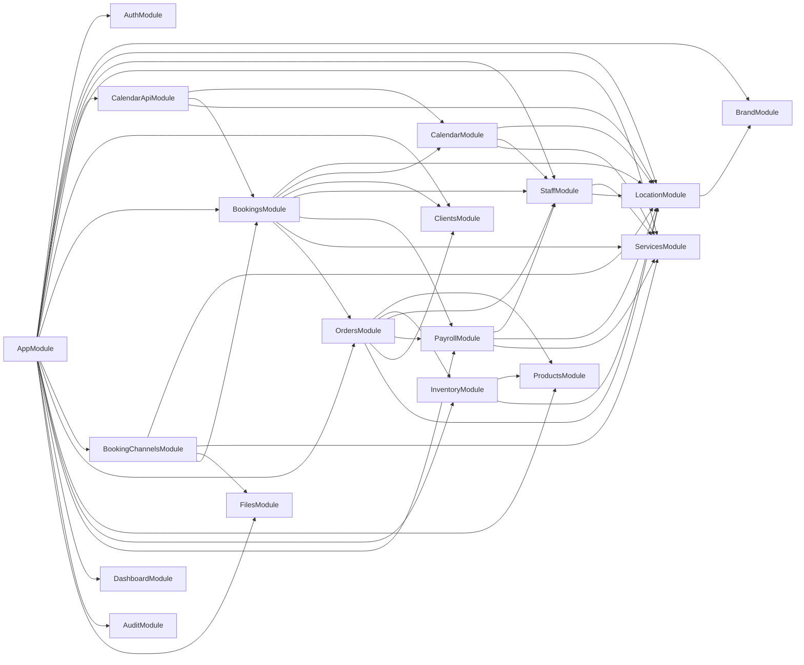
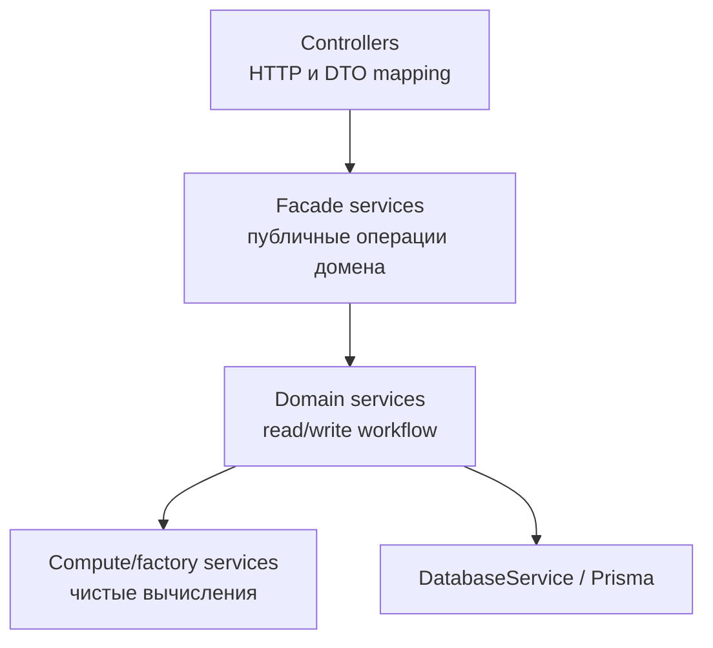

# Архитектура

Эта папка - визуальная карта текущей структуры NestJS-приложения.

Документация собрана по коду 2026-10-12 и затем вручную уточнена по назначению сервисов. Это живая документация: если у сервиса меняется зона ответственности, обновляй соответствующую строку и диаграмму в том же PR.

## Как Читать

- [services-map.md](./services-map.md) отвечает на вопрос: "Какой сервис открыть первым?"
- [domain-ownership.md](./domain-ownership.md) отвечает на вопрос: "Кто владеет этими данными и кто может читать их напрямую?"
- [flows.md](./flows.md) отвечает на вопрос: "Что происходит в основных бизнес-сценариях?"

## Карта Модулей

## Слои

Полезная модель при чтении модуля:

- Controllers принимают HTTP, валидируют DTO и мапят ответ.
- Facade services дают наружу именованные операции домена.
- Domain services оркестрируют запись/чтение и вызовы публичных API других модулей.
- Compute/factory services должны оставаться чистыми или почти чистыми.
- Cross-domain доступ идет через экспортированный сервис владельца домена.
