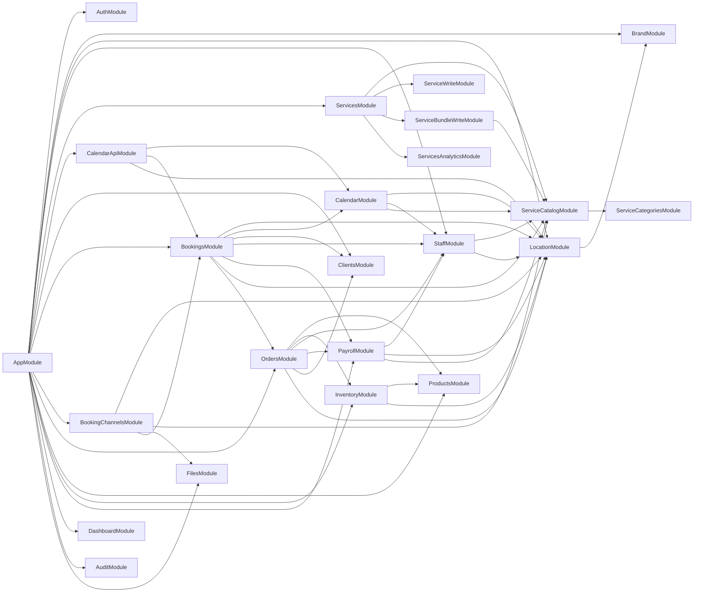
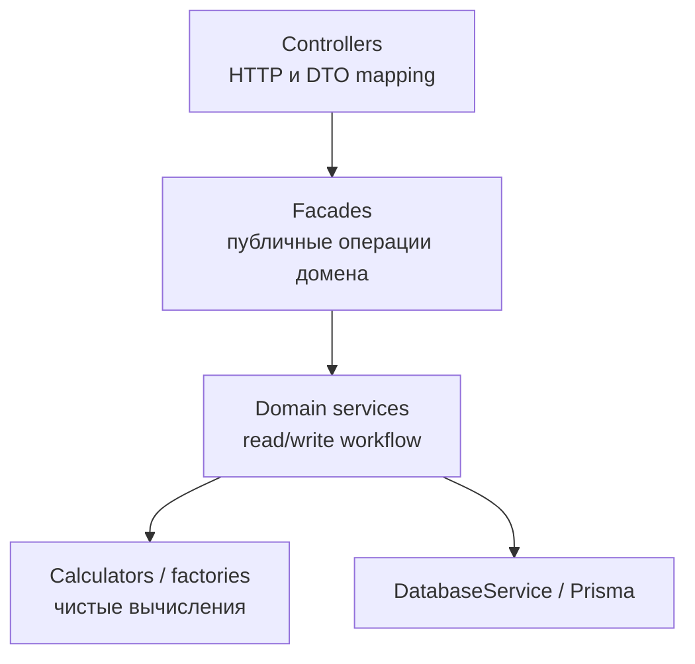

# Архитектура

Эта папка - визуальная карта текущей структуры NestJS-приложения.

Структура и карта компонентов обновлены по коду 2026-10-17. Это живая документация: если у сервиса меняется зона ответственности, обновляй соответствующую строку и диаграмму в том же PR.

## Как Читать

- [rbac-implementation.md](./rbac-implementation.md) — итоговая сводка реализации RBAC: что изменилось, как работает авторизация и что осталось подключить.
- [rbac.md](./rbac.md) сохраняет исторические роли и доступ к API до перехода на permissions.
- [rbac-target.md](./rbac-target.md) описывает реализованные permissions, готовые наборы ролей и настройки.
- [rbac-permissions-map.md](./rbac-permissions-map.md) сопоставляет API-маршруты с целевыми permissions.
- [rbac-contracts.md](./rbac-contracts.md) задаёт контракты настройки прав, управления участниками и единых приглашений.
- [services-catalog.md](./services-catalog.md) — иерархия каталога услуг, границы записи и развёртывание SQL view на пустой базе.
- [services-map.md](./services-map.md) отвечает на вопрос: "Какой сервис открыть первым?"
- [domain-ownership.md](./domain-ownership.md) отвечает на вопрос: "Кто владеет этими данными и кто может читать их напрямую?"
- [flows.md](./flows.md) отвечает на вопрос: "Что происходит в основных бизнес-сценариях?"

## Карта Модулей

## Слои

Полезная модель при чтении модуля:

- Controllers принимают HTTP, валидируют DTO и мапят ответ.
- Фасады дают наружу именованные операции домена.
- Domain services оркестрируют запись/чтение и вызовы публичных API других модулей.
- Calculators выполняют чистые вычисления, factories строят представления; оба не обращаются к БД.
- Cross-domain доступ идет через экспортированный сервис владельца домена.

## Именования и расположение файлов

В корне модуля находятся NestJS-модуль и публичные фасады. Один класс, enum или interface — один файл. Простому домену достаточно сервиса; фасад нужен, когда он координирует несколько исполнителей и даёт единый API.

| Роль | Имя и расположение | Содержание |
| --- | --- | --- |
| Фасад | orders.facade.ts / OrdersFacade | Именованные публичные операции домена и делегирование. |
| HTTP | controllers/*.controller.ts | Валидация входа, DTO mapping, BaseResponseDto; DELETE возвращает 204. |
| Операции с данными | services/*.service.ts | Чтение/запись и транзакции своего домена; чужие данные через API владельца. |
| Вычислитель | calculators/*.calculator.ts | Чистые вычисления; приватный провайдер модуля. |
| Построение представлений | factories/*.factory.ts | Сборка структур/виджетов из уже загруженных данных. |
| Правила | rules/*.rules.ts | Проверки и решения домена без DB-запросов. |
| Контракты | dto/, interfaces/, enums/ | Отдельный файл для каждого DTO, interface и enum. |
| HTTP-помощники | guards/, decorators/, pipes/, interceptors/ | Классы/функции соответствующей роли. |
| Рендеринг | rendering/ или channels/email/ | Шаблоны и их renderer рядом. |
| Утилиты | shared/<область>/*.utils.ts | Статические операции без регистрации как NestJS provider. |

Поддомены группируются по назначению: bookings/export, clients/import, notifications/messages, payroll/periods. Внутри них сохраняется такое же разделение ролей. Модуль экспортирует только провайдеры, которые нужны реальному внешнему потребителю. Прямые импорты внутренних calculators/services другого модуля не допускаются.

Папки с одной ролью называются одинаково во всех модулях. Название родительского домена не повторяется: `clients/export`, `staff/export`, `inventory/export`, `bookings/export`.

| Папка | Назначение |
| --- | --- |
| `analytics/` | Аналитика для экранов: метрики, KPI, виджеты и их API. Используется в bookings, clients, inventory, products, services и staff. |
| `aggregates/` | Агрегирующие запросы и контракты данных для аналитики других модулей. Используется в bookings и orders. |
| `report/` | Подготовка предметных отчётов, ведомостей и их строк. Используется в inventory и payroll. |
| `export/` | Выгрузка данных и экспортные DTO; внутри — `services/` и `dto/`. |
| `import/` | Загрузка данных; внутри используются те же папки типов: `services/`, `dto/`, `interfaces/`, `constants/`, `interceptors/`, `decorators/`. |
| `services/read/`, `services/write/` | Группы сервисов чтения и изменения, когда внутри домена нужно разделить эти операции. |
| `testing/` | Помощники unit-тестов своего домена; исключены из production-сборки. |

`KPI` может обозначать конкретную метрику или DTO внутри аналитики. Для всей функциональности используется папка `analytics/`. Агрегирующие запросы относятся к `aggregates/`, подготовка ведомости — к `report/`.

## Результаты проходов ревью

Разделены создание/изменение бронирований, складские документы/продажи/чтение, расчёт зарплаты и загрузка/построение dashboard. Фасады, вычислители, фабрики и утилиты получили соответствующие имена; ссылки и DI обновлены вместе с файлами. Удалены legacy staff invitations и access.e2e.

Исправлены переходы дат при преобразовании часовых поясов, повторяющиеся/ночные блокировки календаря, освобождение и восстановление слотов, гонки напоминаний и автоматического завершения, обработка boolean query-параметров. Сброс пароля ограничивает попытки и одноразово потребляет код; отзыв JWT хранится в БД. Создание продажи сериализуется по ключу запроса, начисления используют upsert без перехвата ошибки внутри уже прерванной PostgreSQL-транзакции, изменения зарплатного периода проверяют актуальность под блокировкой.

Для проверки есть npm run typecheck, npm run build, npm run lint, npm test и prisma validate. Unit-тесты проверяют обнаруженные регрессии. Полная конкурентность многопроцессного PostgreSQL и внешние OAuth/email-интеграции не проверялись.

Подготовлены, но не применены миграции удаления StaffInvitation, ограничения попыток сброса пароля и сохранения User.tokenEpoch. Схему нужно обновить до запуска новой версии. Старые access JWT с ненулевой версией из прежнего cache потребуют refresh; версия 0 совместима до первого отзыва.

## Оставшийся технический долг

1. **Надёжная доставка событий.** Audit/notification events используют память процесса. В части финансовых сценариев событие всё ещё публикуется внутри внешней транзакции. Нужен transactional outbox, охватывающий всю операцию, и проверка повторной доставки; перенос отдельных emit после commit не даёт гарантии доставки.
2. **Граница закрытия зарплаты.** Изменения самого периода сериализованы, но проверка даты в StaffEarningWriterService и запись начисления не во всех сценариях составляют одну защищённую операцию с утверждением периода. Нужны согласованный протокол блокировок для всех писателей и интеграционные тесты approve/calculate одновременно с начислениями/возвратами.
3. **Ограничение входа.** Лимит попыток кода сброса добавлен; общего распределённого лимита login/reset-request по IP и пользователю пока нет. Его следует вводить вместе с требованиями к общему хранилищу и развёртыванию.

## Пагинация каталогов в БД

InventoryStockReadService читает InventoryStockView — принадлежащее Inventory представление товаров и остатков. Представление соединяет ProductLocation, Product и InventoryBalance на уровне БД; прикладной сервис не запрашивает чужие таблицы и не загружает весь каталог через ProductsService. Товар без InventoryBalance имеет нулевые остаток, стоимость и себестоимость, updatedAt остаётся null. Поиск, фильтры, сортировка, count и LIMIT/OFFSET выполняются в БД. Счётчики дефицита вычисляются отдельной агрегирующей выборкой.

ServiceCatalogReadService выбирает ключи страницы из ServiceCatalogView, объединяющего услуги и bundles. Цена набора равна fixedPrice, когда она задана, иначе сумме цен услуг. Длительность набора включает buffers: сумма для последовательного выполнения и максимум для параллельного. Полные карточки выбранных записей загружаются через приватные ServiceReadService и ServiceBundleReadService, затем собираются ServiceCatalogItemFactory. Фильтрация, сортировка и пагинация происходят до загрузки карточек. Count, ключи и карточки читаются в одной транзакции RepeatableRead. Счётчики по статусу и типу строятся одним агрегирующим запросом к тому же представлению с теми же правилами поиска; каждый счётчик игнорирует фильтр своей группы.

При равенстве основного поля порядок фиксирует ID; для одинакового ID разных типов услуга идёт перед набором. Строки без категории остаются последними в обоих направлениях. Текст сортируется по явной русской ICU-collation catalog_ru, независимо от locale хоста/БД. Поиск считает проценты и подчёркивания обычными символами. Экспорт по прежнему возвращает все подходящие записи.

Миграция 20261017160000_catalog_read_views создаёт обычные представления, без материализации и синхронизации копий. Изменения товаров, остатков и услуг видны сразу. Требуется PostgreSQL с поддержкой ICU; при её отсутствии миграция завершится ошибкой. На исходных таблицах уже есть индексы по филиалу и связям; отдельные индексы для представлений не создаются. Большие OFFSET и общий count по прежнему требуют работы БД, но приложение получает только выбранную страницу. Команды развёртывания и проверки view описаны в [services-catalog.md](./services-catalog.md#пустая-база-и-восстановление-view).

## Ключ создания продажи

При confirmImmediately=true Order.creationRequestHash хранит SHA-256 исходного намерения запроса. В отпечаток входят филиал, клиент, явно заданное время, заметка, товары, количества, пользовательские цены и продавцы. Числа и время нормализуются, товары сортируются по ID. Значение времени по умолчанию и изменяемые цены каталога не участвуют: повтор запроса без occurredAt остаётся тем же запросом и после изменения каталога.

Ключ блокируется до поиска/создания заказа. Совпадающий отпечаток возвращает существующий заказ без повторных движений, начислений и аудита. Другой отпечаток даёт 409 ORDER_IDEMPOTENCY_CONFLICT с responseValue.orderId. Изменение заказа после создания не переписывает отпечаток. Если проведение не удалось, заказ и отпечаток откатываются вместе, после чего тот же запрос можно повторить.

Миграция 20261017150000_validate_sale_request оставляет hash старых продаж пустым: их исходный запрос нельзя восстановить из текущих редактируемых данных. Повтор такого ключа тоже даёт 409 с ID существующего заказа. Клиент должен получить этот заказ по ID и проверить результат, а не автоматически повторять продажу с новым ключом.

Обе новые миграции проверены на изолированной тестовой БД; к настроенной рабочей БД они не применялись.
