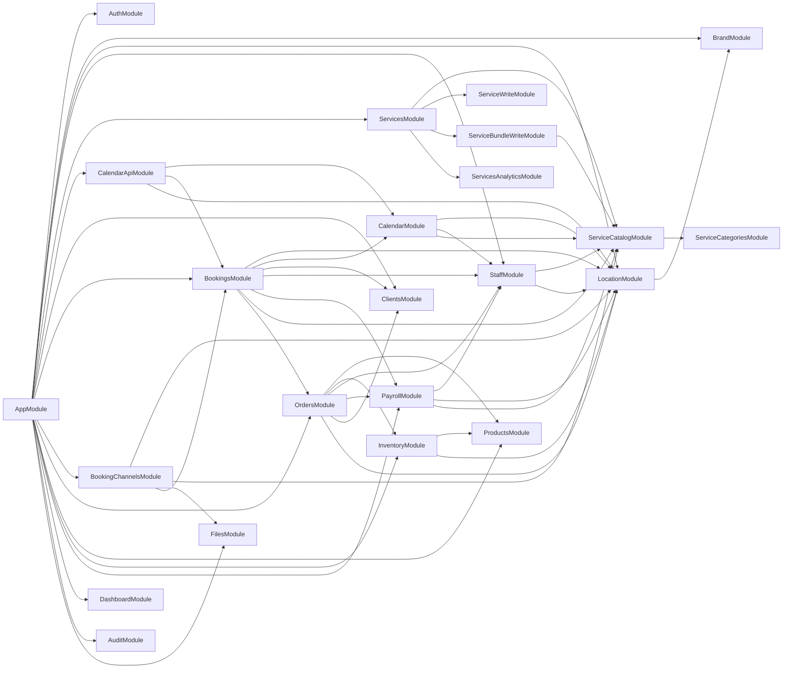
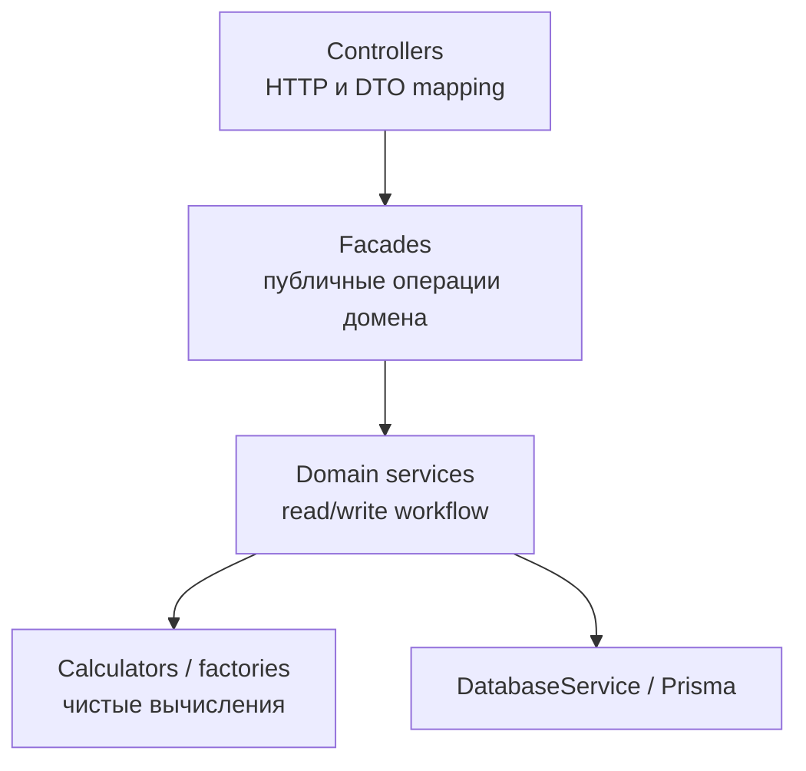

# Архитектура

Эта папка - визуальная карта текущей структуры NestJS-приложения.

Структура и карта компонентов обновлены по коду 2026-10-17. Это живая документация: если у сервиса меняется зона ответственности, обновляй соответствующую строку и диаграмму в том же PR.

## Документы

- [services-map.md](./services-map.md) — публичные API доменов и исполнители операций.
- [domain-ownership.md](./domain-ownership.md) — владельцы таблиц и границы доступа к данным.
- [flows.md](./flows.md) — связи доменов в основных бизнес-сценариях.
- [booking-write-flows.md](./booking-write-flows.md) — запись бронирований, блокировки и восстановление интервалов.
- [services-catalog.md](./services-catalog.md) — каталог услуг, SQL view и развёртывание пустой базы.
- [rbac.md](./rbac.md) — текущая модель ролей, defaults, области и вычисление permissions.
- [rbac-permissions-map.md](./rbac-permissions-map.md) — проверки доступа к HTTP-маршрутам.
- [rbac-contracts.md](./rbac-contracts.md) — политики ролей, назначения, приглашения и отзыв JWT.
- [frontend-access-management.md](../frontend-access-management.md) — интеграция экранов участников, приглашений и настройки ролей.
- [orders.md](../orders.md) — заказы, товарные возвраты, связь с бронированием и идемпотентность.
- [business-soft-delete.md](../business-soft-delete.md) — удаление и восстановление бизнеса.

## Карта Модулей

## Слои

Полезная модель при чтении модуля:

- Controllers принимают HTTP, валидируют DTO и мапят ответ.
- Фасады дают наружу именованные операции домена.
- Domain services оркестрируют запись/чтение и вызовы публичных API других модулей.
- Calculators выполняют чистые вычисления, factories строят представления; оба не обращаются к БД.
- Cross-domain доступ идет через экспортированный сервис владельца домена.

## Именования и расположение файлов

В корне модуля находятся NestJS-модуль и публичные фасады. Один класс, enum или interface — один файл. Простому домену достаточно сервиса; фасад нужен, когда он координирует несколько исполнителей и даёт единый API.

| Роль | Имя и расположение | Содержание |
| --- | --- | --- |
| Фасад | orders.facade.ts / OrdersFacade | Именованные публичные операции домена и делегирование. |
| HTTP | controllers/*.controller.ts | Валидация входа, DTO mapping, BaseResponseDto; DELETE возвращает 204. |
| Операции с данными | services/*.service.ts | Чтение/запись и транзакции своего домена; чужие данные через API владельца. |
| Вычислитель | calculators/*.calculator.ts | Чистые вычисления; приватный провайдер модуля. |
| Построение представлений | factories/*.factory.ts | Сборка структур/виджетов из уже загруженных данных. |
| Правила | rules/*.rules.ts | Проверки и решения домена без DB-запросов. |
| Контракты | dto/, interfaces/, enums/ | Отдельный файл для каждого DTO, interface и enum. |
| HTTP-помощники | guards/, decorators/, pipes/, interceptors/ | Классы/функции соответствующей роли. |
| Рендеринг | rendering/ или channels/email/ | Шаблоны и их renderer рядом. |
| Утилиты | shared/<область>/*.utils.ts | Статические операции без регистрации как NestJS provider. |

Поддомены группируются по назначению: bookings/export, clients/import, notifications/messages, payroll/periods. Внутри них сохраняется такое же разделение ролей. Модуль экспортирует только провайдеры, которые нужны реальному внешнему потребителю. Прямые импорты внутренних calculators/services другого модуля не допускаются.

Папки с одной ролью называются одинаково во всех модулях. Название родительского домена не повторяется: `clients/export`, `staff/export`, `inventory/export`, `bookings/export`.

| Папка | Назначение |
| --- | --- |
| `analytics/` | Аналитика для экранов: метрики, KPI, виджеты и их API. Используется в bookings, clients, inventory, products, services и staff. |
| `aggregates/` | Агрегирующие запросы и контракты данных для аналитики других модулей. Используется в bookings и orders. |
| `report/` | Подготовка предметных отчётов, ведомостей и их строк. Используется в inventory и payroll. |
| `export/` | Выгрузка данных и экспортные DTO; внутри — `services/` и `dto/`. |
| `import/` | Загрузка данных; внутри используются те же папки типов: `services/`, `dto/`, `interfaces/`, `constants/`, `interceptors/`, `decorators/`. |
| `services/read/`, `services/write/` | Группы сервисов чтения и изменения, когда внутри домена нужно разделить эти операции. |
| `testing/` | Помощники unit-тестов своего домена; исключены из production-сборки. |

`KPI` может обозначать конкретную метрику или DTO внутри аналитики. Для всей функциональности используется папка `analytics/`. Агрегирующие запросы относятся к `aggregates/`, подготовка ведомости — к `report/`.

## Оставшийся технический долг

1. **Надёжная доставка событий.** Audit/notification events используют память процесса. В части финансовых сценариев событие всё ещё публикуется внутри внешней транзакции. Нужен transactional outbox, охватывающий всю операцию, и проверка повторной доставки; перенос отдельных emit после commit не даёт гарантии доставки.
2. **Граница закрытия зарплаты.** Изменения самого периода сериализованы, но проверка даты в StaffEarningWriterService и запись начисления не во всех сценариях составляют одну защищённую операцию с утверждением периода. Нужны согласованный протокол блокировок для всех писателей и интеграционные тесты approve/calculate одновременно с начислениями/возвратами.
3. **Ограничение входа.** Лимит попыток кода сброса добавлен; общего распределённого лимита login/reset-request по IP и пользователю пока нет. Его следует вводить вместе с требованиями к общему хранилищу и развёртыванию.

## Чтение каталогов

Каталог услуг и складские остатки читаются через SQL view с фильтрацией, сортировкой и пагинацией в БД. Услуги и комплексы загружаются только для выбранных ключей страницы в одной RepeatableRead-транзакции. View исключают удалённые бренды/филиалы. Определения, collation catalog_ru и восстановление view описаны в [services-catalog.md](./services-catalog.md#пустая-база-и-восстановление-view).

## Проверка изменений

Команды проекта: npm run typecheck, npm run build, npm run lint, npm test. Схема Prisma проверяется через npx prisma validate. Состояние миграций конкретной базы — npx prisma migrate status. Результаты прежних прогонов и статусы отдельных окружений не заменяют проверку текущего изменения.
