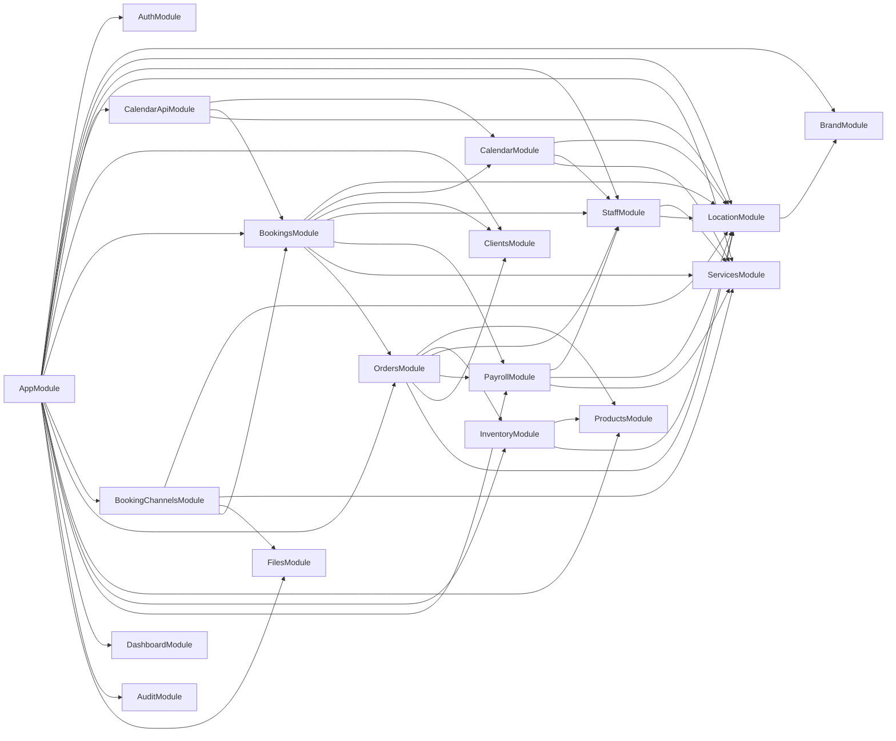
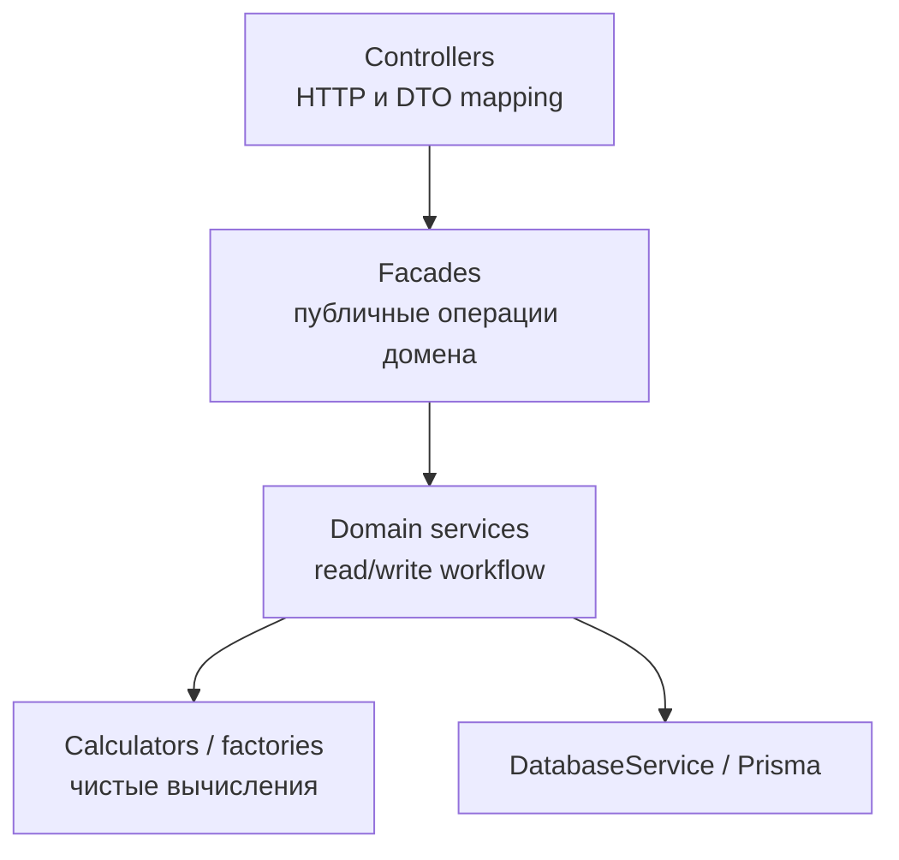

# Архитектура

Эта папка - визуальная карта текущей структуры NestJS-приложения.

Структура и карта компонентов обновлены по коду 2026-10-17. Это живая документация: если у сервиса меняется зона ответственности, обновляй соответствующую строку и диаграмму в том же PR.

## Как Читать

- [rbac-implementation.md](./rbac-implementation.md) — итоговая сводка реализации RBAC: что изменилось, как работает авторизация и что осталось подключить.
- [rbac.md](./rbac.md) сохраняет исторические роли и доступ к API до перехода на permissions.
- [rbac-target.md](./rbac-target.md) описывает реализованные permissions, готовые наборы ролей и настройки.
- [rbac-permissions-map.md](./rbac-permissions-map.md) сопоставляет API-маршруты с целевыми permissions.
- [rbac-contracts.md](./rbac-contracts.md) задаёт контракты настройки прав, управления участниками и единых приглашений.
- [services-map.md](./services-map.md) отвечает на вопрос: "Какой сервис открыть первым?"
- [domain-ownership.md](./domain-ownership.md) отвечает на вопрос: "Кто владеет этими данными и кто может читать их напрямую?"
- [flows.md](./flows.md) отвечает на вопрос: "Что происходит в основных бизнес-сценариях?"

## Карта Модулей

## Слои

Полезная модель при чтении модуля:

- Controllers принимают HTTP, валидируют DTO и мапят ответ.
- Фасады дают наружу именованные операции домена.
- Domain services оркестрируют запись/чтение и вызовы публичных API других модулей.
- Calculators выполняют чистые вычисления, factories строят представления; оба не обращаются к БД.
- Cross-domain доступ идет через экспортированный сервис владельца домена.

## Именования и расположение файлов

В корне модуля находятся NestJS-модуль и публичные фасады. Один класс, enum или interface — один файл. Простому домену достаточно сервиса; фасад нужен, когда он координирует несколько исполнителей и даёт единый API.

| Роль | Имя и расположение | Содержание |
| --- | --- | --- |
| Фасад | orders.facade.ts / OrdersFacade | Именованные публичные операции домена и делегирование. |
| HTTP | controllers/*.controller.ts | Валидация входа, DTO mapping, BaseResponseDto; DELETE возвращает 204. |
| Операции с данными | services/*.service.ts | Чтение/запись и транзакции своего домена; чужие данные через API владельца. |
| Вычислитель | calculators/*.calculator.ts | Чистые вычисления; приватный провайдер модуля. |
| Построение представлений | factories/*.factory.ts | Сборка структур/виджетов из уже загруженных данных. |
| Правила | rules/*.rules.ts | Проверки и решения домена без DB-запросов. |
| Контракты | dto/, interfaces/, enums/ | Отдельный файл для каждого DTO, interface и enum. |
| HTTP-помощники | guards/, decorators/, pipes/ | Классы/функции соответствующей роли. |
| Рендеринг | rendering/ или channels/email/ | Шаблоны и их renderer рядом. |
| Утилиты | shared/<область>/*.utils.ts | Статические операции без регистрации как NestJS provider. |

Поддомены группируются по назначению: bookings/export, clients/import, notifications/messages, payroll/periods. Внутри них сохраняется такое же разделение ролей. Модуль экспортирует только провайдеры, которые нужны реальному внешнему потребителю. Прямые импорты внутренних calculators/services другого модуля не допускаются.

## Результаты проходов ревью

Разделены создание/изменение бронирований, складские документы/продажи/чтение, расчёт зарплаты и загрузка/построение dashboard. Фасады, вычислители, фабрики и утилиты получили соответствующие имена; ссылки и DI обновлены вместе с файлами. Удалены legacy staff invitations и access.e2e.

Исправлены переходы дат при преобразовании часовых поясов, повторяющиеся/ночные блокировки календаря, освобождение и восстановление слотов, гонки напоминаний и автоматического завершения, обработка boolean query-параметров. Сброс пароля ограничивает попытки и одноразово потребляет код; отзыв JWT хранится в БД. Создание продажи сериализуется по ключу запроса, начисления используют upsert без перехвата ошибки внутри уже прерванной PostgreSQL-транзакции, изменения зарплатного периода проверяют актуальность под блокировкой.

Для проверки есть npm run typecheck, npm run build, npm run lint, npm test и prisma validate. Типы тестовых fixtures приведены к текущей Prisma-схеме. Unit-тесты проверяют обнаруженные регрессии; реальная PostgreSQL-конкурентность и внешние OAuth/email-интеграции здесь не запускались.

Подготовлены, но не применены миграции удаления StaffInvitation, ограничения попыток сброса пароля и сохранения User.tokenEpoch. Схему нужно обновить до запуска новой версии. Старые access JWT с ненулевой версией из прежнего cache потребуют refresh; версия 0 совместима до первого отзыва.

## Оставшийся технический долг

1. **Надёжная доставка событий.** Audit/notification events используют память процесса. В части финансовых сценариев событие всё ещё публикуется внутри внешней транзакции. Нужен transactional outbox, охватывающий всю операцию, и проверка повторной доставки; перенос отдельных emit после commit не даёт гарантии доставки.
2. **Граница закрытия зарплаты.** Изменения самого периода сериализованы, но проверка даты в StaffEarningWriterService и запись начисления не во всех сценариях составляют одну защищённую операцию с утверждением периода. Нужны согласованный протокол блокировок для всех писателей и интеграционные тесты approve/calculate одновременно с начислениями/возвратами.
3. **Рост каталогов.** InventoryReadService.searchInventory и объединённый service catalog сортируют/фильтруют загруженные данные перед пагинацией. Для больших каталогов нужны измерения и read model с фильтрацией/пагинацией на стороне БД.
4. **Контракт ключа продажи.** Повтор create с тем же idempotencyKey возвращает исходную продажу даже при другом теле запроса. Групповое проведение и возвраты уже проверяют requestHash; для создания продажи нужно отдельно закрепить такой же контракт и хранить отпечаток запроса.
5. **Ограничение входа.** Лимит попыток кода сброса добавлен; общего распределённого лимита login/reset-request по IP и пользователю пока нет. Его следует вводить вместе с требованиями к общему хранилищу и развёртыванию.
