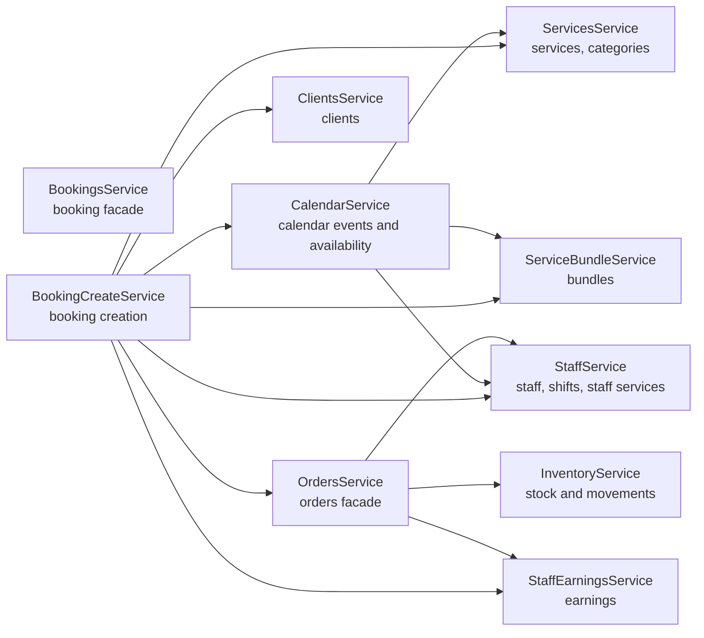

# Владение Доменами

Этот файл фиксирует, какой сервис считается владельцем каждой области данных. Сервис читает чужой домен только через публичный API владельца, если в коде не описано транзакционное исключение.

## Таблица Владения

| Данные                                                                                | Основной владелец                                            | API для других модулей                                                                     | Заметки                                                                                   |
| ------------------------------------------------------------------------------------- | ------------------------------------------------------------ | ------------------------------------------------------------------------------------------ | ----------------------------------------------------------------------------------------- |
| `User`                                                                                | `UserService`                                                | `UserService`                                                                              | Auth использует это для регистрации и поиска пользователя.                                |
| `RefreshToken`, `PasswordResetCode`                                                   | `AuthService`                                                | `AuthService`                                                                              | Очистка просроченных refresh token вынесена в `AuthCleanupService`.                       |
| `Brand`, `BrandMembership`                                                            | `BrandService`                                               | `BrandService`                                                                             | При изменении доступа обновляется token epoch.                                            |
| `Location`, `LocationMembership`                                                      | `LocationService` / guards доступа                           | `LocationService`                                                                          | `StaffService` сейчас читает `locationMembership` для staff access flows.                 |
| `Client`                                                                              | `ClientsService`                                             | `ClientsService`                                                                           | Booking/order flow должны резолвить клиента через `ClientsService`.                       |
| `ServiceCategory`, `Service`                                                          | `ServicesService`                                            | `ServicesService`, `ServiceCatalogService`                                                 | Для каталога лучше использовать `ServiceCatalogService`.                                  |
| `ServiceBundle`, `ServiceBundleItem`                                                  | `ServiceBundleService`                                       | `ServiceBundleService`, `ServiceCatalogService`                                            | Booking setup не должен вручную пересобирать правила каталога bundle.                     |
| `Staff`, `StaffInvitation`, `StaffShift`, `StaffService`                              | `StaffService`                                               | `StaffService`                                                                             | KPI/export/cleanup helpers остаются внутри Staff module.                                  |
| `CalendarEvent`, `CalendarEventCancelledOccurrence`                                   | `CalendarService` facade, реализация в calendar sub-services | `CalendarService`                                                                          | `CalendarComputeService` приватный для Calendar и не экспортируется.                      |
| `Booking`, `BookingItem`                                                              | `BookingsService` facade, реализация в booking sub-services  | `BookingsService`, `BookingCreateService`, `BookingCalendarReadService` где экспортированы | Создание, мутации и чтение разделены внутри модуля.                                       |
| `BookingPage`, `BookingWidget`                                                        | `BookingPagesService`, `BookingWidgetsService`               | Booking channel services/controllers                                                       | Проверка публикации живет в `BookingChannelPublishService`.                               |
| `ProductCategory`, `Product`, `ProductLocation`                                       | `ProductsService`                                            | `ProductsService`                                                                          | Inventory и Orders резолвят товары через `ProductsService`.                               |
| `InventoryBalance`, `InventoryDocument`, `InventoryDocumentItem`, `InventoryMovement` | `InventoryService`                                           | `InventoryService`                                                                         | Низкоуровневая блокировка остатков изолирована в `InventoryBalanceLockService`.           |
| `Order`, `OrderItem`, `OrderOperation`, `OrderReturn`, `OrderReturnItem`              | `OrdersService` facade, реализация в order sub-services      | `OrdersService`, `OrderComputeService` только там, где он явно экспортирован               | Product transitions, persistence, booking sync и returns разделены на внутренние сервисы. |
| `StaffCompensationPlan`, `StaffCompensationServiceRate`                               | `StaffCompensationService`                                   | `StaffCompensationService` внутри Payroll module                                           | Наружу из Payroll сейчас не экспортируется.                                               |
| `StaffEarning`                                                                        | `StaffEarningsService`                                       | `StaffEarningsService`                                                                     | Низкоуровневые вставки идут через `StaffEarningWriterService`.                            |
| `PayrollPeriod`, `PayrollResult`                                                      | `PayrollService`                                             | `PayrollService` внутри Payroll controllers                                                | `StaffEarningsService` участвует в materialization периода.                               |
| `AuditLog`                                                                            | `AuditService`                                               | `AuditService` / `AUDIT_EVENT`                                                             | Транзакционные записи идут через `AuditService.writeInTransaction`.                       |
| `File`                                                                                | `FilesService`                                               | `FilesService`                                                                             | Booking pages используют файлы для cover/media.                                           |

## Места, Где Границы Легко Размыть

Это не обязательно баги. Это точки, где стоит быть особенно внимательным:

- `BookingCreateService` теперь резолвит услуги и bundle через `ServicesService`/`ServiceBundleService`. Если pricing бронирований станет сложнее, держи catalog resolution внутри catalog services, а не возвращай прямые `service`/`serviceBundle` queries в booking orchestration.
- `BookingMutationService` и `OrderAuditService` теперь пишут audit через `AuditService.writeInTransaction`. Новые транзакционные audit writes лучше добавлять туда же, чтобы payload/storage правила не расползались по доменам.
- `CalendarApiModule` импортирует `BookingsModule`, чтобы собрать календарный view с деталями booking. Держи эту зависимость на API adapter layer; не протаскивай booking read services в приватные calendar compute services.
- `OrdersModule` экспортирует `OrderComputeService`. Сейчас он чистый и нужен booking creation, но важно оставить его только вычислительным сервисом, а не превратить в cross-domain data gateway.

## Направление Зависимостей

