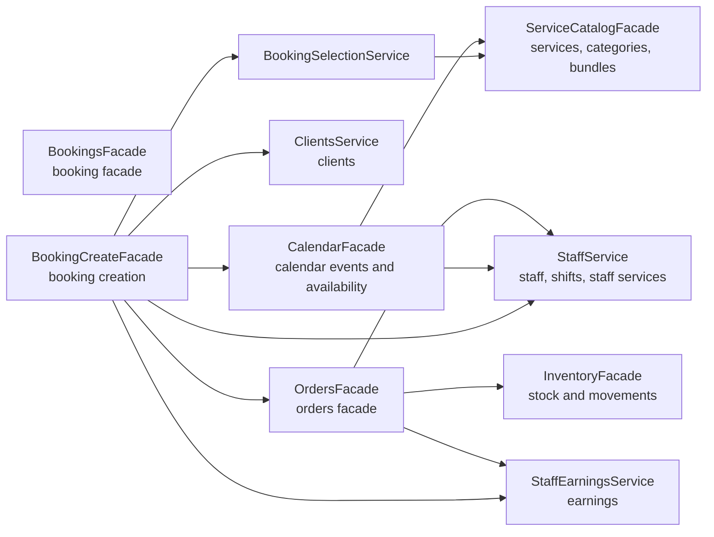

# Владение Доменами

Этот файл фиксирует, какой сервис считается владельцем каждой области данных. Сервис читает чужой домен только через публичный API владельца, если в коде не описано транзакционное исключение.

## Таблица Владения

| Данные                                                                                | Основной владелец                                            | API для других модулей                                                                     | Заметки                                                                                   |
| ------------------------------------------------------------------------------------- | ------------------------------------------------------------ | ------------------------------------------------------------------------------------------ | ----------------------------------------------------------------------------------------- |
| `User`                                                                                | `UserService`                                                | `UserService`                                                                              | Auth использует это для регистрации и поиска пользователя.                                |
| `RefreshToken`, `PasswordResetCode`                                                   | `AuthService`, `PasswordResetService`                        | `AuthService`                                                                              | Очистка просроченных refresh token вынесена в `AuthCleanupService`.                       |
| `Brand`                                                            | `BrandService`                                               | `BrandService`                                                                             | При изменении доступа обновляется token epoch.                                            |
| `Location`                                                      | `LocationService` / guards доступа                           | `LocationService`                                                                          | Членство и permissions принадлежат AccessModule.                 |
| `BrandMembership`, `LocationMembership`, permission overrides, `AccessInvitation`, grants | `AccessModule` | `AccessService`, `AccessAdministrationService` через `AccessManagementFacade` | Изменения выполняются с проверкой актуальных прав под блокировкой. |
| `Client`                                                                              | `ClientsService`                                             | `ClientsService`                                                                           | Booking/order flow должны резолвить клиента через `ClientsService`.                       |
| `ServiceCategory` | `ServiceCategoriesService` | `ServiceCatalogFacade` для каталога бронирования | Категории управляются в ServiceCategoriesModule. |
| `Service` | `ServiceReadService`, `ServiceWriteService` | `ServiceCatalogFacade` | Чтение приватно для каталога; запись приватна для ServiceWriteModule. |
| `ServiceBundle`, `ServiceBundleItem` | `ServiceBundleReadService`, `ServiceBundleWriteService` | `ServiceCatalogFacade` | Чтение приватно для каталога; запись и проверка состава находятся в ServiceBundleWriteModule. |
| `Staff`, `StaffShift`, `StaffService`                              | `StaffService`                                               | `StaffService`                                                                             | KPI/export/cleanup helpers остаются внутри Staff module.                                  |
| `CalendarEvent`, `CalendarEventCancelledOccurrence`                                   | `CalendarFacade` facade, реализация в calendar sub-services | `CalendarFacade`                                                                          | `CalendarCalculator` приватный для Calendar и не экспортируется.                      |
| `Booking`, `BookingItem`                                                              | `BookingsFacade` facade, реализация в booking sub-services  | `BookingsFacade`, `BookingCreateFacade`, `BookingCalendarReadService` где экспортированы | Создание, мутации и чтение разделены внутри модуля.                                       |
| `BookingPage`, `BookingWidget`                                                        | `BookingPagesService`, `BookingWidgetsService`               | Booking channel services/controllers                                                       | Проверка публикации живет в `BookingChannelPublishService`.                               |
| `ProductCategory`, `Product`, `ProductLocation`                                       | `ProductsService`                                            | `ProductsService`                                                                          | Inventory и Orders резолвят товары через `ProductsService`.                               |
| `InventoryBalance`, `InventoryDocument`, `InventoryDocumentItem`, `InventoryMovement` | `InventoryFacade`                                           | `InventoryFacade`                                                                         | Низкоуровневая блокировка остатков изолирована в `InventoryBalanceLockService`.           |
| `Order`, `OrderItem`, `OrderOperation`, `OrderReturn`, `OrderReturnItem`              | `OrdersFacade` facade, реализация в order sub-services      | `OrdersFacade`               | Product transitions, persistence, booking sync и returns разделены на внутренние сервисы. |
| `StaffCompensationPlan`, `StaffCompensationServiceRate`                               | `StaffCompensationService`                                   | `StaffCompensationService` внутри Payroll module                                           | Наружу из Payroll сейчас не экспортируется.                                               |
| `StaffEarning`                                                                        | `StaffEarningsService`                                       | `StaffEarningsService`                                                                     | Низкоуровневые вставки идут через `StaffEarningWriterService`.                            |
| `PayrollPeriod`, `PayrollResult`                                                      | `PayrollPeriodService`                                             | `PayrollPeriodService` внутри Payroll controllers                                                | `StaffEarningsService` участвует в materialization периода.                               |
| `AuditLog`                                                                            | `AuditService`                                               | `AuditService` / `AUDIT_EVENT`                                                             | События AUDIT_EVENT обрабатываются AuditService; durable outbox пока отсутствует.                       |
| `File`                                                                                | `FilesService`                                               | `FilesService`                                                                             | Booking pages используют файлы для cover/media.                                           |

| Представление | Владелец | Публичный API | Назначение |
| --- | --- | --- | --- |
| InventoryStockView | InventoryStockReadService | InventoryFacade | Read-only представление склада; объединение метаданных товаров и остатков находится в определении view. |
| ServiceCatalogView | ServiceCatalogReadService | ServiceCatalogFacade | Общие ключи/метрики каталога; подробности страницы загружаются через владельцев услуг/bundles. |

## Границы модулей

- BookingCreateFacade делегирует выбор услуг BookingSelectionService, который использует ServiceCatalogFacade. Чужие таблицы из bookings не запрашиваются.
- CalendarApiModule соединяет публичный API CalendarModule с BookingCalendarReadService. Внутренний CalendarCalculator не знает о бронированиях и не экспортируется.
- OrderPricingCalculator не экспортируется. Общая денежная арифметика лежит в shared/money и не зависит от orders.
- UserService владеет сохранённым tokenEpoch. Auth и AccessManagement вызывают его через TokenEpochRegistryService; при изменении ролей версия обновляется в той же транзакции.
- Членство, permissions, generic invitations и grants принадлежат AccessModule; привязка сотрудника остаётся операцией StaffService.
- Аудит редактирования/удаления заказа и отмены/удаления брони публикуется после успешного commit. Остальные события и надёжность доставки описаны в [ограничениях ревью](./README.md#оставшийся-технический-долг).

## Направление Зависимостей

