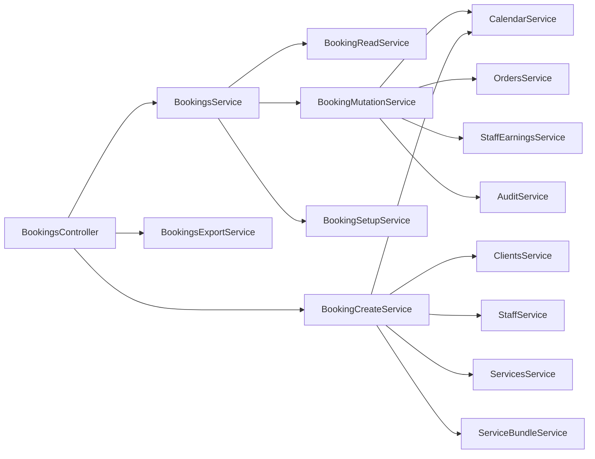
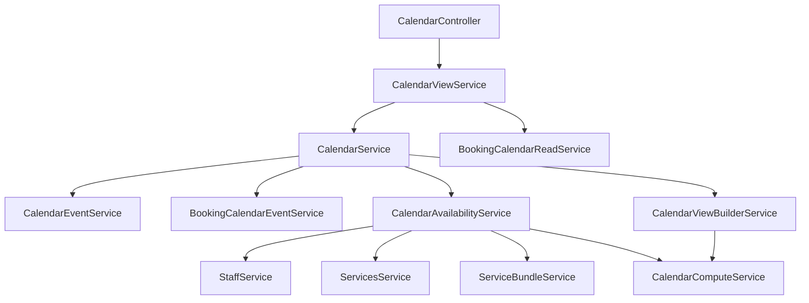
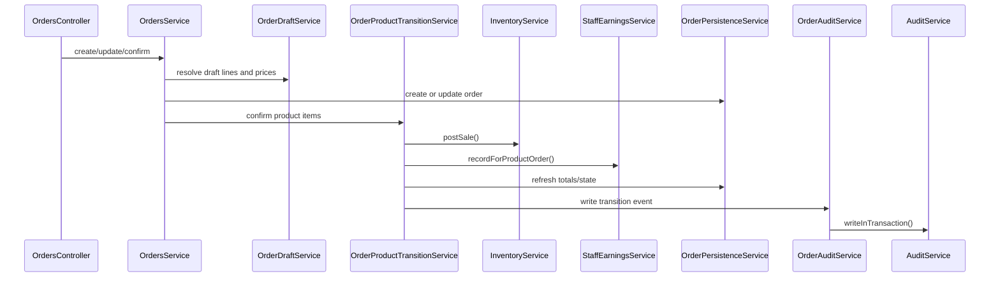
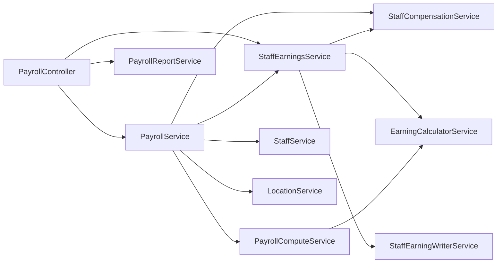
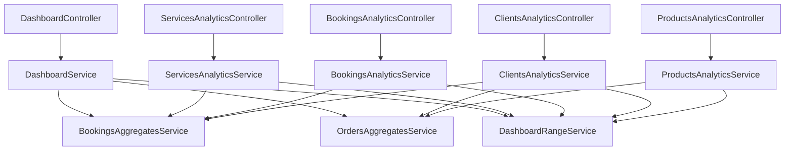

# Бизнес-Сценарии

Диаграммы показывают основные orchestration paths. DTO mapping и guards намеренно скрыты, чтобы было проще увидеть ответственность сервисов.

## Публичное Создание Брони

```mermaid
sequenceDiagram
  participant PublicController as PublicBookingCreateController
  participant Attribution as BookingChannelAttributionService
  participant Create as BookingCreateService
  participant Services as ServicesService
  participant Bundles as ServiceBundleService
  participant Clients as ClientsService
  participant Staff as StaffService
  participant Calendar as CalendarService
  participant Orders as OrdersService
  participant Earnings as StaffEarningsService
  participant DB as DatabaseService

  PublicController->>Attribution: resolve(page/widget)
  PublicController->>Create: createPublicBooking()
  Create->>Services: resolveActiveForBooking()
  Create->>Bundles: resolveActiveForBooking()
  Create->>Clients: resolveForBooking()
  Create->>Staff: resolveStaffingForServices()
  Create->>Calendar: isSlotFree() / createBookingEvent()
  Create->>DB: create booking and booking items
  Create->>Orders: sync/create related order state
  Create->>Earnings: record when booking work is completed
```

## Ручное Управление Бронью



## Календарь И Доступность



## Заказ С Продажей Товара



## Возврат По Заказу


## Расчет Зарплаты



## Паттерн Аналитики


