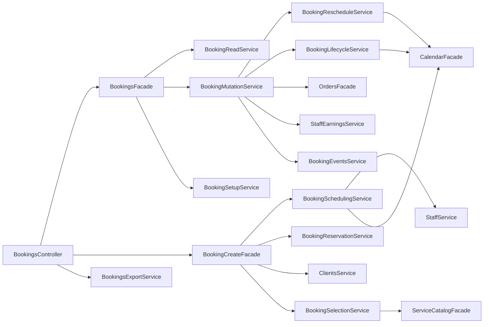
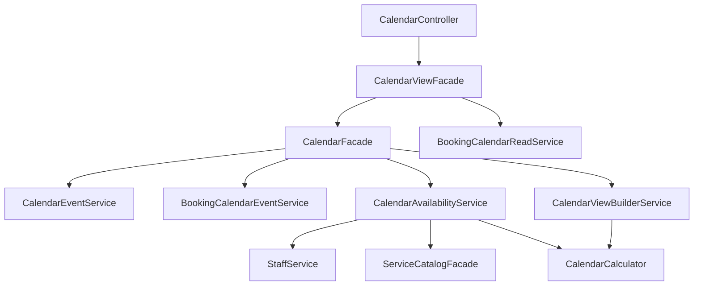
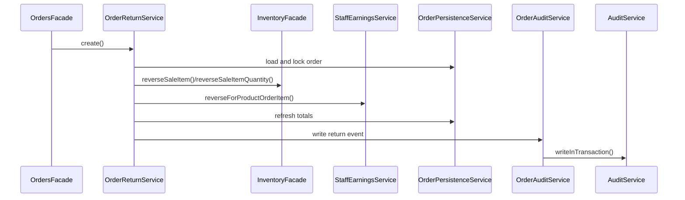
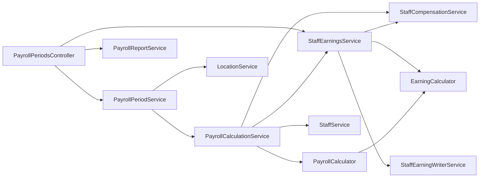

# Бизнес-Сценарии

Диаграммы показывают основные orchestration paths. DTO mapping и guards намеренно скрыты, чтобы было проще увидеть ответственность сервисов.

## Публичное Создание Брони

```mermaid
sequenceDiagram
  participant PublicController as PublicBookingCreateController
  participant Attribution as BookingChannelAttributionService
  participant Create as BookingCreateFacade
  participant Selection as BookingSelectionService
  participant Scheduling as BookingSchedulingService
  participant Reservation as BookingReservationService
  participant Slots as BookingSlotLockService
  participant Catalog as ServiceCatalogFacade
  participant Clients as ClientsService
  participant Staff as StaffService
  participant Calendar as CalendarFacade
  participant Orders as OrdersFacade
  participant Earnings as StaffEarningsService
  participant DB as DatabaseService

  PublicController->>Attribution: resolve(page/widget)
  PublicController->>Create: createPublicBooking()
  Create->>Selection: resolve()
  Selection->>Catalog: resolveServicesForBooking() / resolveBundleForBooking()
  Create->>Clients: resolveForBooking()
  Create->>Scheduling: resolveForBooking()
  Scheduling->>Staff: resolveStaffForService()
  Scheduling->>Calendar: filterAvailableStaff()
  Create->>Reservation: reserve()
  Reservation->>Slots: lock staff days and recheck availability
  Reservation->>Calendar: createBookingEvent() in transaction
  Reservation->>DB: create booking and booking items
  Note over Reservation,DB: Заказ и начисления синхронизируются только для соответствующего сценария создания
  Reservation->>Orders: sync completed booking / add draft products when applicable
  Reservation->>Earnings: record when booking work is completed
```

## Ручное Управление Бронью



## Календарь И Доступность



## Заказ С Продажей Товара


## Возврат По Заказу



## Расчет Зарплаты



## Паттерн Аналитики


