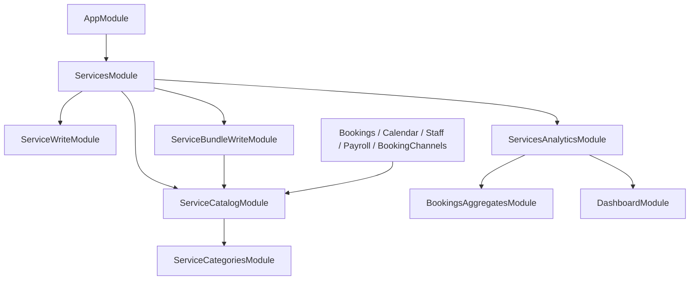

# Каталог услуг

`ServicesModule` подключается в `AppModule` и собирает каталог с его дочерними сценариями. Другие домены импортируют `ServiceCatalogModule` и используют только `ServiceCatalogFacade`. Сервисы записи и внутренние читатели наружу не экспортируются.

```text
services/
  services.module.ts             # подключение функциональности домена
  catalog/                       # поиск, счётчики, карточки, выбор для бронирования
    service-catalog.module.ts
    service-catalog.facade.ts    # публичный API чтения для других доменов
    controllers/
    services/                    # внутренние читатели услуг, бандлов и SQL view
    dto/
    interfaces/
    factories/
  categories/                    # чтение и изменение категорий, их аудит
    controllers/
    services/
    dto/
  service-write/                 # создание, изменение, статус, удаление услуг и аудит
    controllers/
    services/
    dto/
  bundle-write/                  # запись бандлов, проверка состава и цены, аудит
    controllers/
    services/
    dto/
  analytics/                     # виджеты по агрегатам бронирований
    controllers/
    services/
    dto/
    interfaces/
    enums/
```

Общие enums, константы, DTO смены статуса и расчёт метрик бандла находятся в корне домена. HTTP-маршруты и permissions сохранены. Чтение карточки по ID ограничено филиалом из URL.



`ServiceCatalogFacade` предоставляет поиск и счётчики, карточки услуг/бандлов, каталог для настройки бронирования, разрешение активных услуг и бандла для записи, проверку услуг для компенсаций, выбор ID для KPI и количество доступных для записи услуг. `ServiceCatalogReadService`, `ServiceReadService`, `ServiceBundleReadService` и `ServiceCatalogItemFactory` приватны для модуля каталога.

`ServiceCategoriesService` владеет категориями и экспортируется только для сборки каталога. `ServiceWriteService` владеет изменением услуг. `ServiceBundleWriteService` владеет изменением бандлов и их состава; активные услуги своего филиала он проверяет через `ServiceCatalogFacade`. Аналитика получает историю через `BookingsAggregatesService`, не зависит от сервисов записи и не меняет каталог.

Поиск выбирает count и ключи страницы из `ServiceCatalogView`, затем загружает только карточки выбранных услуг и бандлов. Все три шага используют одну транзакцию `RepeatableRead`. Цена бандла — `fixedPrice`, если она задана, иначе сумма цен услуг. Длительность включает buffers: сумма при последовательном исполнении, максимум при параллельном. Статусы, типы, поиск, сортировка и пагинация обрабатываются в БД.

## Пустая база и восстановление view

Источник SQL-определения — [миграция 20261017160000_catalog_read_views](../../src/database/migrations/20261017160000_catalog_read_views/migration.sql). Она создаёт `ServiceCatalogView`, `InventoryStockView` и русскую ICU-collation `catalog_ru`. Это обычные view: изменения исходных таблиц видны сразу, отдельное обновление не требуется.

[Миграция 20261017170000_filter_deleted_business_views](../../src/database/migrations/20261017170000_filter_deleted_business_views/migration.sql) обновляет оба view: записи удалённых филиалов и брендов исключаются через `deletedAt IS NULL`. Такое же условие входит в Prisma-запросы карточек, категорий и каталога бронирования. После восстановления бизнеса данные снова видны без копирования или пересоздания записей. Проверка выполняется в самих выборках и не зависит от HTTP-пути.

View управляются SQL-миграциями и читаются через Prisma `$queryRaw`; деклараций `view` в `schema.prisma` нет. В начале схемы оставлена ссылка на миграцию и этот документ. Не нужно создавать вместо view Prisma `model`: это превратило бы представление в таблицу.

После настройки `DATABASE_URL` для новой PostgreSQL-базы с поддержкой ICU выполните из корня репозитория:

```sh
npm run db:deploy
npm run db:generate
npm run build
```

`db:deploy` выполняет `prisma migrate deploy` и применяет всю историю, включая создание представлений и collation. Для разработки `npm run db:migrate` также применяет SQL-миграции. `npm run db:push` не воспроизводит SQL view и collation и не является способом полноценного развёртывания пустой базы.

Проверка после развёртывания:

```sql
SELECT viewname FROM pg_views
WHERE schemaname = 'public'
  AND viewname IN ('ServiceCatalogView', 'InventoryStockView');

SELECT collname, collprovider FROM pg_collation WHERE collname = 'catalog_ru';

SELECT COUNT(*) FROM "ServiceCatalogView";
```

Ожидаются два представления, collation с `collprovider = 'i'` и успешный запрос count, в том числе на пустом каталоге.

Если будущая миграция меняет столбцы, от которых зависит view, она должна явно пересоздать view в том же SQL-файле. Для восстановления существующей базы, где миграция отмечена применённой, но view удалено вручную, нужна отдельная корректирующая миграция: повторный `migrate deploy` не запускает уже применённые миграции.
