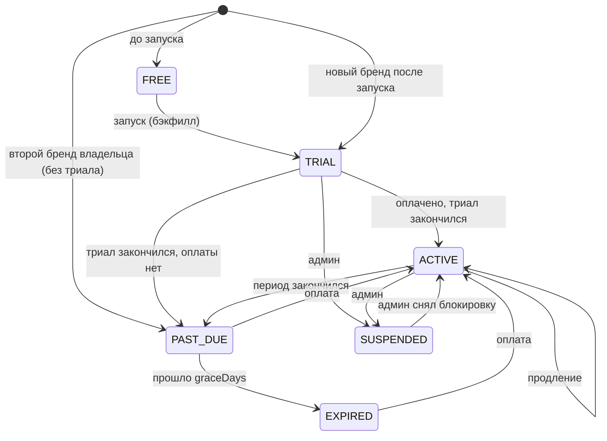
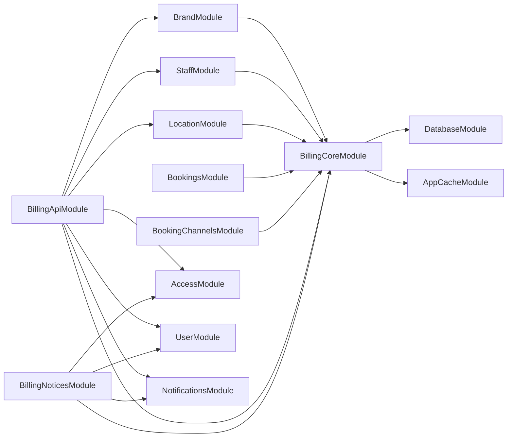

# Тарифы и подписки: план

Статус: план, реализация не начата. Обновлён 2026-11-15.

Модуль биллинга целиком: тарифы и цены по странам с кэшем, публичный API цен, подписка бренда с пробным месяцем, офлайн-оплата с подтверждением админом, платёжный слой под будущий bePaid, смена тарифа, лимиты, блокировка после просрочки, напоминания, админка платформы.

## Коротко

- Подписка принадлежит **бренду**: один бренд — одна подписка.
- Тарифы, цены и настройки лежат в БД и редактируются в админке (`/admin/billing/*`, `UserRole.ADMIN`). Сайт берёт цены из `GET /public/billing/plans?country=BY` вместо констант `TARIFFS`.
- Цены задаются по стране в её валюте. Сейчас только BY / BYN, налог включён. Страна без своих цен платит по ценам BY.
- Изменение цены — новая версия с датой начала. Оплаченные периоды не меняются.
- **Триал 30 дней** без тарифа, лимитов и карты. Один на пользователя-владельца. Существующие бренды получают его в день запуска.
- **Оплата сейчас только офлайн.** Владелец создаёт **запрос на продление** с зафиксированной суммой и номером `KL-000123`. Админ связывается, получает деньги и нажимает «Оплачено». Юрлица пока нет, поэтому текст после запроса — «Мы свяжемся с вами». После юрлица там будут реквизиты.
- **bePaid позже** — ещё один `PaymentProvider`. Модель платежа, API владельца, правила продления и фронтенд не меняются (10.2, 11).
- Автосписаний нет. Не оплатил — доступ не продлевается, долга нет.
- После окончания доступа — **3 льготных дня** с полным доступом. Это отсрочка, а не бесплатные дни: оплата в них считается от даты окончания доступа (4.3).
- Открытый запрос один раз продлевает льготный период ещё на 3 дня (4.2).
- Период считается **от даты** с якорным днём (2.4).
- После льготного периода **блокирует только фронтенд**: страница блокировки вместо кабинета. API кабинета и бизнес-модули не меняются. На бэкенде закрывается только онлайн-запись (6).
- Данные не удаляются. Выгрузка работает и в блокировке.
- Тарифы отличаются только лимитами: места сотрудников и филиалы. Превышение мягкое (5.4).
- Раздел «Подписка» видят только владельцы бренда (`Claim.BILLING`).
- Запуск — флаг `BillingSettings.launchedAt`. До него сервис бесплатный: подписок, баннеров, лимитов и блокировок нет. Блокировки и лимиты дополнительно включаются флагом `enforcementEnabled` (13).

## Принятые решения

| Вопрос | Решение | Основание |
| --- | --- | --- |
| Тарифы на старте | `master` (1 место, 1 филиал) 29 / 290 BYN, `team` (5 мест, 1 филиал) 59 / 590 BYN, `network` — индивидуально | текущий `/pricing` |
| Место сотрудника | `Staff.status = ACTIVE` в неудалённых филиалах бренда. Профиль владельца занимает место, управляющий без профиля — нет | — |
| Страна бренда | Снимок страны первого филиала, меняет админ | владелец продукта |
| Налоги и документы | Цены итоговые. Акты и чеки модуль не формирует | владелец продукта |
| Изменение цены | Новая версия с `effectiveFrom`, действует для новых заявок | соглашение, п. 3 |
| Кому триал | Один раз на пользователя («первый месяц после регистрации»). Второй бренд — без триала, админ может выдать. При запуске — всем брендам | соглашение, п. 3 |
| Выбор тарифа | Когда кончается триал. Оплатить раньше можно, дни триала не сгорают | `/pricing` |
| Возвраты | Нет. Отмена — отказ от продления | соглашение, п. 3 |
| Смена тарифа | Сразу, сам владелец. Остаток пересчитывается в дни нового тарифа (4.4) | `/pricing` |
| Превышение лимитов | Мягкое: существующее работает, новое добавить нельзя | `/pricing` |
| Удаление за неоплату | Нет. Только по желанию владельца (`docs/business-soft-delete.md`) | `/pricing`, соглашение, п. 4 |
| «Сеть» | `pricingMode = CUSTOM`: лимиты и цену задаёт админ на подписке | `/pricing` |
| Кэш | Процессный `AppCacheService` + `Cache-Control` и ISR на фронте (7) | — |

## 1. Что есть сейчас

**Бэкенд.** Подписок, тарифов и лимитов нет. Что пригодится:

- `UserRole.ADMIN`, `PlatformAdminGuard` — по образцу `admin/feedback`, `admin/support-requests`.
- `BrandService.create` создаёт бренд, первый филиал и владельца в одной транзакции. Здесь стартует триал.
- `Location.countryCode`, `currency`, `timezone`; `COUNTRY_DEFAULTS` в `src/shared/geo/country-defaults.ts`.
- `permission-registry.ts`: `action()` без настраиваемых ролей — «только владелец».
- `AppCacheService` + `defineCache` (`src/shared/cache`).
- `NotificationsService`, платформенные письма (`confirm-email`, `reset-password`).
- Крон по образцу `BookingCronService.sendReminders`.
- `TimeUtils.zonedDayStart`, `addDaysInTz`, `addMonthsInTz`. Нужен новый `addMonthsAnchoredInTz(date, months, anchorDay, tz)`: `addMonthsInTz` берёт день из `date`, и на 29–31 числах дата уплывает (2.4).
- `MoneyUtils`, `@IsPrice()`, `Decimal(10,2)`.

**Фронтенд.** Цены зашиты в `TARIFFS` (`src/entities/marketing/model/product.ts`), используются в `pricing.ts`, `home.ts`, `for-whom-hub.ts`, `faqs.ts`, `structured-data.ts`. Маркетинг статический. `/admin` — заглушка. В соглашении: «Сейчас сервис бесплатный. О введении платных тарифов предупредим не позднее чем за 14 дней».

### 1.1 Что уже обещано клиентам

Тексты `/pricing`, FAQ и соглашения — обязательства. Модуль их выполняет.

| Обещание | Следствие |
| --- | --- |
| «Первый месяц бесплатно» на каждом тарифе, включая «Сеть» | Триал без тарифа и лимитов (4.1, 5.2) |
| «Все возможности открыты с первого дня» | Возможности одинаковы, тарифы различаются только лимитами |
| «Тариф выбираете, когда пробный месяц закончится» | В триале `planId = null` |
| «Без карты», «Платёж подключается, когда вы решите остаться» | Оплата — только действие владельца |
| «Если не подойдёт, просто не продлевайте» | Неоплата — не долг (4.3) |
| «Помесячно» / «На год — выгоднее на 17%», по умолчанию год | `MONTH` и `YEAR`, скидка из цен (7.1) |
| «Перейти на другой тариф можно в любой момент» | Смена тарифа сразу (4.4) |
| «Данные остаются вашими… можно выгрузить» | Выгрузка работает в блокировке (6) |
| «Предупредим не позднее чем за 14 дней» | До запуска ничего не ограничено, при запуске месяц триала (13) |
| «Оплата заранее… по ценам со страницы «Тарифы»» | Сумма — текущая цена на момент заявки |
| «Отменить можно в любой момент: доступ сохранится» | Отменять нечего: без оплаты подписка заканчивается. С онлайн-оплатой — `autoRenew` (11.3) |
| «Оплата за начавшийся период не возвращается» | Возвратов нет |
| «Можете удалить аккаунт… данные удаляются в течение 30 дней» | Текущее мягкое удаление (4.7) |

## 2. Понятия

| Понятие | Что это |
| --- | --- |
| Тариф (`BillingPlan`) | Набор лимитов. Стабильный `code`: `master`, `team`, `network` |
| Цена (`BillingPlanPrice`) | Сумма за `MONTH` / `YEAR` для страны, с `effectiveFrom`. Не редактируется: изменение — новая строка |
| Страна цен | Страна подписки, если для неё есть цены, иначе страна по умолчанию |
| Настройки (`BillingSettings`) | Одна строка |
| Подписка (`Subscription`) | Даты, тариф, страна, индивидуальные условия бренда |
| Платёж (`SubscriptionPayment`) | Запрос владельца, зачёт или продление админом. Провайдер — поле `provider` |
| Провайдер | Реализация `PaymentProvider`. Сейчас `OFFLINE`, позже `BEPAID` |
| Событие (`SubscriptionEvent`) | История подписки |
| Напоминание (`SubscriptionNotice`) | Ключ идемпотентности рассылки |

### 2.1 Состояние подписки

Состояние **не хранится**, а вычисляется из дат при запросе. Крон для смены статусов не нужен.

```text
accessEndsAt = max(trialEndsAt, paidUntil ?? -∞)
graceEndsAt  = max(
  addDaysInTz(accessEndsAt, settings.graceDays, tz),
  graceExtendedUntil ?? -∞     // открытый запрос на продление (4.2)
)
```

| Состояние | Условие | Доступ |
| --- | --- | --- |
| `FREE` | строки подписки нет (до запуска) | Полный, без лимитов и баннеров. После запуска — ошибка бэкфилла: то же плюс `logger.error` |
| `SUSPENDED` | `suspendedAt != null` | Заблокирован (6) |
| `TRIAL` | `now < trialEndsAt` | Полный, без лимитов |
| `ACTIVE` | `trialEndsAt <= now < accessEndsAt` | Полный, лимиты тарифа |
| `PAST_DUE` | `accessEndsAt <= now < graceEndsAt` | Полный, красный баннер. Лимиты тарифа, если он выбран |
| `EXPIRED` | `now >= graceEndsAt` | Заблокирован (6) |

Оплата во время триала: до `trialEndsAt` — `TRIAL`, затем `ACTIVE`. `SUSPENDED` — флаг поверх дат, снятие возвращает состояние по датам.



### 2.2 Границы периодов и часовой пояс

`Subscription.timezone` — снимок пояса первого филиала, не меняется. Все периоды заканчиваются на границе местных суток.

```text
Триал: trialEndsAt = addDaysInTz(zonedDayStart(trialStartedAt, tz), trialDays, tz)
Месяц: end = addMonthsAnchoredInTz(start, 1, billingAnchorDay, tz)
Год:   end = addMonthsAnchoredInTz(start, 12, billingAnchorDay, tz)
```

Пример: бренд создан 14 ноября, триал 30 дней → `trialEndsAt` = 14 декабря 00:00 по Минску, в интерфейсе «до 13 декабря включительно». Месячная оплата в триале → `paidUntil` = 14 января 00:00.

API отдаёт и момент в UTC (`accessEndsAt`), и местную дату последнего дня (`lastAccessDate: 'YYYY-MM-DD'`).

### 2.3 Страна и валюта

```text
pricingCountry =
  subscription.countryCode     если у неё есть хотя бы одна действующая цена
  settings.defaultCountryCode  иначе
```

- Выбирается страна целиком: валюты в одном ответе не смешиваются. Тариф без цены в этой стране — `prices: null`, купить нельзя.
- У страны одна валюта, по умолчанию из `COUNTRY_DEFAULTS`.
- Платёж хранит снимок страны, валюты и суммы.
- Сейчас все бренды, включая RU и KZ, платят BYN.

### 2.4 Расчётный период: от даты

Период идёт от даты начала: 14 декабря → 13 января включительно. Сумма всегда равна цене тарифа, пересчёта по дням нет.

**Якорный день.** Без него дата уплывает: 31 января → 28 февраля → 28 марта. Подписка хранит `billingAnchorDay` — день месяца по поясу подписки:

```text
end = addMonthsAnchoredInTz(start, n, billingAnchorDay, tz)
      день = min(billingAnchorDay, дней в целевом месяце), 00:00 по tz
```

Якорь 31: 31 января → 28 февраля → 31 марта → 30 апреля.

| Ситуация | `billingAnchorDay` |
| --- | --- |
| Оплата продолжает цепочку (`periodStart = paidUntil`) | не меняется |
| Первая оплата, оплата после блокировки, после продлённого триала | день `periodStart` |
| Пересчёт остатка при смене тарифа (4.4) | день нового `paidUntil` |

**Почему не календарные месяцы:** понадобились бы пересчёт неполных месяцев по дням, неровные суммы и доплаты при смене тарифа. Если позже понадобятся акты за календарный месяц, переход — один период «от `paidUntil` до 1-го числа» по дням и `billingAnchorDay = 1`.

## 3. Схема данных

Таблицы принадлежат домену биллинга (10). Каждая фаза — своя миграция (14). Поля онлайн-оплаты — в разделе 11.

```prisma
enum BillingPeriod {
  MONTH
  YEAR
}

enum BillingPlanStatus {
  ACTIVE
  ARCHIVED // новые заявки запрещены, текущие подписки работают
}

enum BillingPlanPricingMode {
  STANDARD // цены из BillingPlanPrice, владелец выбирает сам
  CUSTOM   // лимиты и цена на подписке, назначает админ
}

enum SubscriptionPaymentStatus {
  PENDING
  PAID      // конечный
  FAILED    // отказ провайдера (у OFFLINE не бывает)
  CANCELED  // заменён новой заявкой или отменён
  EXPIRED   // срок заявки прошёл
}

// Новые провайдеры: ALTER TYPE ... ADD VALUE.
enum SubscriptionPaymentProvider {
  OFFLINE       // подтверждает админ
  COMPLIMENTARY // продление без оплаты, amount = 0
}

enum SubscriptionPaymentMethod {
  BANK_TRANSFER
  ERIP
  CASH
  CARD
  OTHER
  NONE   // COMPLIMENTARY
}

enum SubscriptionEventType {
  TRIAL_STARTED
  TRIAL_SKIPPED        // триал уже израсходован в другом бренде
  TRIAL_EXTENDED
  GRACE_EXTENDED       // льготный период продлён открытым запросом
  PAYMENT_CREATED
  PAYMENT_CANCELED
  PAYMENT_EXPIRED
  PAYMENT_FAILED
  PAYMENT_APPLIED
  PAYMENT_MISMATCH     // подтверждена другая сумма или валюта
  PLAN_CHANGED
  PERIOD_EXTENDED      // продление без оплаты
  CUSTOM_TERMS_CHANGED
  COUNTRY_CHANGED
  SUSPENDED
  RESUMED
}

enum SubscriptionNoticeKind {
  TRIAL_ENDING
  PERIOD_ENDING
  ACCESS_ENDED    // начался льготный период
  ACCESS_LIMITED  // блокировка
}

enum BillingActorRole {
  OWNER
  ADMIN
  SYSTEM
  PROVIDER
}

model BillingPlan {
  id            String                 @id @default(uuid())
  code          String                 @unique @db.VarChar(50) // неизменяемый
  name          String                 @db.VarChar(100)
  position      Int                    @db.SmallInt
  status        BillingPlanStatus      @default(ACTIVE)
  isPublic      Boolean                @default(true)
  pricingMode   BillingPlanPricingMode @default(STANDARD)
  staffLimit    Int?                   // null — без ограничения
  locationLimit Int?
  createdAt     DateTime               @default(now())
  updatedAt     DateTime               @updatedAt
  updatedById   String?

  prices        BillingPlanPrice[]
  subscriptions Subscription[]
  payments      SubscriptionPayment[]

  @@index([status, position])
}

// Неизменяемая строка. Текущая цена — последняя с effectiveFrom <= now для (planId, countryCode, billingPeriod).
// Будущую версию можно удалить, действующую — нельзя.
model BillingPlanPrice {
  id            String        @id @default(uuid())
  planId        String
  countryCode   String        @db.VarChar(2)
  currency      String        @db.VarChar(3)  // одна на страну, проверяет сервис
  billingPeriod BillingPeriod
  amount        Decimal       @db.Decimal(10, 2) // с налогом
  effectiveFrom DateTime
  createdById   String?
  createdAt     DateTime      @default(now())

  plan BillingPlan @relation(fields: [planId], references: [id], onDelete: Restrict)

  @@unique([planId, countryCode, billingPeriod, effectiveFrom])
  @@index([countryCode])
}

// Одна строка, создаётся миграцией.
model BillingSettings {
  id                         Int                         @id @default(1)
  defaultCountryCode         String                      @default("BY") @db.VarChar(2)
  trialDays                  Int                         @default(30) @db.SmallInt
  graceDays                  Int                         @default(3) @db.SmallInt
  reminderDaysBefore         Int[]                       @default([7, 3, 1])
  paymentProvider            SubscriptionPaymentProvider @default(OFFLINE) // провайдер заявок владельцев
  paymentRequestTtlDays      Int                         @default(14) @db.SmallInt
  pendingRequestGraceDays    Int                         @default(3) @db.SmallInt  // продление льготного периода запросом
  offlinePaymentInstructions String?                     @db.VarChar(5000) // текст после запроса
  adminNotifyEmail           String?                     @db.VarChar(254)
  launchedAt                 DateTime?                   // null — платные тарифы не запущены
  enforcementEnabled         Boolean                     @default(false)   // выключатель лимитов и блокировки
  updatedAt                  DateTime                    @updatedAt
  updatedById                String?
}

model Subscription {
  id                  String         @id @default(uuid())
  brandId             String         @unique
  countryCode         String         @db.VarChar(2)  // снимок первого филиала, меняет админ
  timezone            String         @db.VarChar(64) // снимок первого филиала
  planId              String?        // null — тариф не выбран
  billingPeriod       BillingPeriod? // период последней оплаты
  billingAnchorDay    Int?           @db.SmallInt // 2.4; null до первой оплаты

  trialStartedAt      DateTime
  trialEndsAt         DateTime       // = trialStartedAt, если триала нет
  trialUserId         String?        // чей триал израсходован; частичный UNIQUE
  paidUntil           DateTime?
  accessEndsAt        DateTime       // max(trialEndsAt, paidUntil), для индекса
  graceExtendedUntil  DateTime?      // продление запросом (4.2)
  graceExtendedFor    DateTime?      // accessEndsAt, для которого продление уже выдано

  customStaffLimit    Int?           // перекрывают тариф
  customLocationLimit Int?
  customCurrency      String?        @db.VarChar(3)
  customMonthlyPrice  Decimal?       @db.Decimal(10, 2)
  customYearlyPrice   Decimal?       @db.Decimal(10, 2)

  suspendedAt         DateTime?
  suspendReason       String?        @db.VarChar(500)

  createdAt           DateTime       @default(now())
  updatedAt           DateTime       @updatedAt

  brand    Brand                 @relation(fields: [brandId], references: [id], onDelete: Cascade)
  plan     BillingPlan?          @relation(fields: [planId], references: [id], onDelete: Restrict)
  payments SubscriptionPayment[]
  events   SubscriptionEvent[]
  notices  SubscriptionNotice[]

  @@index([accessEndsAt])
  @@index([planId])
}

// Общая для всех провайдеров. Специфичное — только externalId и providerData.
model SubscriptionPayment {
  id             String                      @id @default(uuid()) // = tracking_id у онлайн-провайдера
  number         Int                         @unique @default(autoincrement()) // KL-000123
  subscriptionId String
  brandId        String                      // денормализация

  planId         String
  planName       String                      @db.VarChar(100) // снимок
  billingPeriod  BillingPeriod
  countryCode    String                      @db.VarChar(2)   // снимок страны цен
  currency       String                      @db.VarChar(3)
  amount         Decimal                     @db.Decimal(10, 2) // снимок

  provider       SubscriptionPaymentProvider
  status         SubscriptionPaymentStatus   @default(PENDING)
  method         SubscriptionPaymentMethod?

  externalId     String?                     @db.VarChar(255)
  providerData   Json?
  reference      String?                     @db.VarChar(255) // номер платёжки, вводит админ
  failureReason  String?                     @db.VarChar(500)
  ownerComment   String?                     @db.VarChar(1000)

  expiresAt      DateTime?
  paidAt         DateTime?                   // фактическая дата оплаты (4.3)
  confirmedAt    DateTime?
  periodStart    DateTime?                   // заполняются при применении
  periodEnd      DateTime?

  createdById    String?
  createdByRole  BillingActorRole
  confirmedById  String?
  adminNote      String?                     @db.VarChar(2000) // владельцу не отдаётся
  createdAt      DateTime                    @default(now())
  updatedAt      DateTime                    @updatedAt

  subscription Subscription @relation(fields: [subscriptionId], references: [id], onDelete: Cascade)
  plan         BillingPlan  @relation(fields: [planId], references: [id], onDelete: Restrict)

  @@unique([provider, externalId])
  @@index([brandId, createdAt, id])
  @@index([status, createdAt, id])
  @@index([status, expiresAt])
}

model SubscriptionEvent {
  id             String                @id @default(uuid())
  subscriptionId String
  brandId        String
  type           SubscriptionEventType
  actorId        String?
  actorRole      BillingActorRole
  payload        Json                  // до / после, paymentId, причина
  createdAt      DateTime              @default(now())

  subscription Subscription @relation(fields: [subscriptionId], references: [id], onDelete: Cascade)

  @@index([subscriptionId, createdAt, id])
}

model SubscriptionNotice {
  id             String                 @id @default(uuid())
  subscriptionId String
  kind           SubscriptionNoticeKind
  anchorAt       DateTime               // accessEndsAt или graceEndsAt
  daysBefore     Int                    @db.SmallInt // 0 для ACCESS_ENDED и ACCESS_LIMITED
  sentAt         DateTime               @default(now())

  subscription Subscription @relation(fields: [subscriptionId], references: [id], onDelete: Cascade)

  @@unique([subscriptionId, kind, anchorAt, daysBefore])
}
```

В `Brand` — обратная связь `subscription Subscription?`.

SQL в миграциях:

- `BillingSettings`: `CHECK (id = 1)`, строка по умолчанию, `CHECK ("paymentProvider" <> 'COMPLIMENTARY')`.
- `BillingPlanPrice`: `CHECK (amount > 0)`.
- `SubscriptionPayment`: `CHECK (amount >= 0)`, `CHECK ((provider = 'COMPLIMENTARY') = (amount = 0))`.
- `Subscription`: `CHECK ("accessEndsAt" >= "trialEndsAt")`, `CHECK ("paidUntil" IS NULL OR "accessEndsAt" >= "paidUntil")`.
- Частичные уникальные индексы:
  ```sql
  CREATE UNIQUE INDEX "SubscriptionPayment_one_pending"
    ON "SubscriptionPayment" ("subscriptionId") WHERE "status" = 'PENDING';
  CREATE UNIQUE INDEX "Subscription_one_trial_per_user"
    ON "Subscription" ("trialUserId") WHERE "trialUserId" IS NOT NULL;
  ```
- Сид (`countryCode = BY`, `currency = BYN`, `effectiveFrom` — дата миграции):

  | code | name | staffLimit | locationLimit | pricingMode | MONTH | YEAR |
  | --- | --- | --- | --- | --- | --- | --- |
  | `master` | Мастер | 1 | 1 | STANDARD | 29.00 | 290.00 |
  | `team` | Команда | 5 | 1 | STANDARD | 59.00 | 590.00 |
  | `network` | Сеть | null | null | CUSTOM | — | — |

Подписки создаёт запуск (13), а не миграция.

## 4. Жизненный цикл

Все изменения подписки — через `SubscriptionService`, в транзакции с `SELECT … FOR UPDATE` на `Subscription`. Каждое пишет `SubscriptionEvent`. После коммита — сброс кэша бренда (7.2).

### 4.1 Старт подписки

До запуска (`launchedAt = null`) подписок нет, бренды в `FREE`.

После запуска `BrandService.create` в своей транзакции вызывает:

```ts
await this.billing.startSubscription(brand.id, userId, { countryCode: location.countryCode, timezone: location.timezone }, tx);
```

`startSubscription` читает настройки из БД внутри транзакции, а не из кэша: иначе бренд, созданный сразу после запуска, останется без подписки.

| Случай | Поля | Событие |
| --- | --- | --- |
| Первый бренд пользователя (нет подписки с `trialUserId = userId`, удалённые тоже учитываются) | `trialUserId = userId`, `trialEndsAt` по 2.2, `accessEndsAt = trialEndsAt` | `TRIAL_STARTED` |
| Следующий бренд | `trialUserId = null`, `trialEndsAt = accessEndsAt = zonedDayStart(now, tz)` → сразу `PAST_DUE`, 3 дня на оплату | `TRIAL_SKIPPED` |

- `planId = null` до выбора тарифа.
- Гонку двух созданий первого бренда снимает частичный индекс: при конфликте подписка создаётся без триала.
- Один триал на человека, иначе удаление и пересоздание бренда дают бесконечный бесплатный доступ.
- Форма создания бренда предупреждает «Пробный месяц уже использован в «{brand}»» по `GET /users/me/trial-eligibility`.
- Продлить триал может только админ (`TRIAL_EXTENDED`). Без оплаты вместе с `trialEndsAt` сдвигается `accessEndsAt`.
- **Пилот:** `POST /admin/billing/subscriptions/:brandId/start { trialEndsOn }` создаёт подписку одному бренду до запуска. Так всё проверяется на стенде и своём бренде.

### 4.2 Оплата

Два слоя:
- `SubscriptionPaymentService` — заявки, статусы, подтверждение. Не знает, как платят.
- `PaymentProvider` (10.2) — как начать оплату и узнать результат. Сейчас для заявок только `OFFLINE`.

#### Запрос на продление

В интерфейсе — «Запрос на продление», в коде — `SubscriptionPayment` в `PENDING`. Он даёт:
- сумма и тариф зафиксированы;
- номер `KL-000123` для назначения платежа;
- очередь и письмо админу;
- API уже такое, как будет с юрлицом и bePaid: меняются текст и провайдер, а не код.

`offlinePaymentInstructions` меняется без деплоя:
- сейчас: «Мы получили запрос и свяжемся с вами в течение рабочего дня» и контакты;
- после юрлица: реквизиты и «укажите в назначении платежа KL-000123».

`POST /brands/:brandId/subscription/payments { planCode, billingPeriod, comment? }` из раздела «Подписка» или со страницы блокировки:

1. Проверки:
   - тариф `ACTIVE`, `isPublic`, `STANDARD`, либо текущий `CUSTOM` тариф подписки с индивидуальной ценой;
   - есть действующая цена в стране цен (2.3);
   - использование помещается в лимиты (5.3), иначе `PLAN_USAGE_EXCEEDS_LIMITS`. **Исключение — заблокированный бренд:** отключить лишних сотрудников он не может, поэтому проверка пропускается, а после оплаты он попадает в мягкое превышение (5.4). Админ видит такие бренды по фильтру `overLimit`.
2. В транзакции:
   - открытая `PENDING` заявка → `CANCELED`;
   - создаётся платёж: `provider = settings.paymentProvider`, снимок тарифа, страны, валюты, суммы, `expiresAt = now + paymentRequestTtlDays`; событие `PAYMENT_CREATED`;
   - **продление льготного периода**, если состояние `PAST_DUE`, `provider.capabilities.adminConfirmable` и `graceExtendedFor ≠ accessEndsAt`:
     - `graceExtendedUntil = addDaysInTz(обычный graceEndsAt, pendingRequestGraceDays, tz)`;
     - `graceExtendedFor = accessEndsAt`;
     - событие `GRACE_EXTENDED`.

     Один раз за цикл: отмена и повторный запрос второй раз не продлевают. Запрос в `EXPIRED` не разблокирует, иначе он стал бы способом бесплатно работать.
3. После коммита `provider.start(payment)` → `nextAction`. Для `OFFLINE`:
   ```ts
   { type: 'INSTRUCTIONS', instructions, reference: 'KL-000123', amount: '590.00', currency: 'BYN', expiresAt }
   ```
4. Письма: владельцам `subscription-payment-requested`, админу на `adminNotifyEmail` — `admin-subscription-payment-requested`.
5. Ответ `{ payment, nextAction }`.

Владелец может отменить свою заявку. Крон переводит просроченные `PENDING` в `EXPIRED`. Просроченную заявку по старой цене может подтвердить только админ.

#### Подтверждение админом

Очередь «Ожидают оплаты» → «Оплачено» с полями:
- `paidAt` — по умолчанию сегодня, не в будущем, не раньше заявки;
- `method`, `reference`, `adminNote`.

Подтверждать можно `PENDING`, `EXPIRED`, `CANCELED`. Сумма не меняется. Пришла другая сумма — отменить заявку и зачесть оплату вручную.

#### Действия админа без заявки

- **«Зачесть оплату»** — `OFFLINE`, `createdByRole = ADMIN`: тариф, период, сумма, валюта, `paidAt`. Создаётся и сразу применяется. Для «Сети» и договорённостей.
- **«Продлить без оплаты»** — `COMPLIMENTARY`, `amount = 0`, `method = NONE`, событие `PERIOD_EXTENDED`.

#### Применение оплаты

Одна точка входа для всех провайдеров: кнопка админа сейчас, вебхук и сверка потом.

```text
SubscriptionPaymentService.confirm(paymentId, { paidAt, method, externalId?, reference?, amount, currency, actor })
  amount / currency ≠ снимок → PAYMENT_MISMATCH, logger.error, не применяем

  lock Subscription FOR UPDATE
  UPDATE SubscriptionPayment SET status = PAID, paidAt, confirmedAt = now, method, externalId, reference, confirmedById
    WHERE id = :id AND status IN (PENDING, CANCELED, EXPIRED, FAILED)
    → 0 строк: уже PAID, выходим (идемпотентно)

  SubscriptionService.applyPayment(subscription, payment, tx):
    другой тариф и есть оплаченный остаток → пересчёт остатка (4.4)
    start  = periodStart(subscription, payment.paidAt)                   // 4.3
    anchor = start == paidUntil ? billingAnchorDay : localDay(start, tz) // 2.4
    end    = addMonthsAnchoredInTz(start, MONTH ? 1 : 12, anchor, tz)
    Subscription: planId, billingPeriod, billingAnchorDay = anchor, paidUntil = end, accessEndsAt = max(trialEndsAt, end)
    Payment:      periodStart = start, periodEnd = end
    Event PAYMENT_APPLIED
```

После коммита — сброс кэша и письмо `subscription-payment-received`. Если тариф заархивирован или бренд вырос, пока заявка ждала, оплата всё равно применяется, подписка попадает в превышение (5.4).

### 4.3 С какой даты считается оплаченный период

Опорная дата — **`paidAt`** (фактическая оплата), а не момент нажатия «Оплачено»: задержка подтверждения не должна стоить владельцу дней.

Льготный период — отсрочка: оплата в него считается от даты, когда платить было нужно.

```text
periodStart =
  paidAt < graceEndsAt → accessEndsAt              // заранее или в льготные дни
  иначе                → zonedDayStart(paidAt, tz) // после блокировки: с дня оплаты
```

| Когда платят | Начало | Пример (триал до 13 декабря вкл., месяц) |
| --- | --- | --- |
| В триале, 5 декабря | 14 декабря | до 13 января, дни триала не сгорают |
| В льготный период после триала, 16 декабря | 14 декабря | до 13 января |
| В льготный период после оплаты (оплачено до 13 января, платят 15-го) | 14 января | до 13 февраля |
| После блокировки, 20 декабря | 20 декабря | до 19 января |
| Второй бренд (создан 10 декабря), платят 12-го | 10 декабря | до 9 января |

- **Неоплата не создаёт долг:** льготные дни входят в период, только если владелец сам в них платит.
- **После блокировки — с дня оплаты:** в дни блокировки работать было нельзя. Лазейку «заплатить сразу после льготного периода и получить 3 дня» принимаем: ради неё нужно просидеть в блокировке. Если начнутся злоупотребления, правило ужесточается без миграций.
- Подтверждение после блокировки сразу возвращает доступ, дни считаются от `paidAt`. Очередь разбирается ежедневно.

### 4.4 Смена тарифа

- **Без оплаченного остатка** (триал, льготные дни) — просто выбор тарифа в заявке.
- **С оплаченным остатком** — сразу, без доплаты и возврата. Остаток пересчитывается по дневным ценам:

```text
paidFrom      = max(now, trialEndsAt)   // остаток триала не пересчитывается
remaining     = paidUntil − paidFrom
oldDailyPrice = price(oldPlan, billingPeriod, pricingCountry) / days(billingPeriod)
newDailyPrice = price(newPlan, billingPeriod, pricingCountry) / days(billingPeriod)
newPaidUntil  = paidFrom + remaining × oldDailyPrice / newDailyPrice
                до границы местных суток, половина дня — вверх
```

- Пример: 20 дней «Мастера» (29/мес) → ~10 дней «Команды» (59/мес), и наоборот.
- Меньший тариф — только если использование помещается в его лимиты.
- Открытая заявка отменяется.
- Расчёт до подтверждения — `GET …/subscription/plan-change-quote`.
- `billingAnchorDay` = день нового `paidUntil` (2.4).
- Событие `PLAN_CHANGED` с `paidUntil` до и после.
- `CUSTOM` меняет только админ, владельцу — `SUBSCRIPTION_PLAN_MANAGED_BY_SUPPORT`.

**Почему не доплата:** при офлайн-оплате доплата — это заявка и ожидание, а «пришёл второй мастер» ждать не может.

### 4.5 Окончание и блокировка

| Событие | Состояние | Что происходит |
| --- | --- | --- |
| `accessEndsAt` | `PAST_DUE` | Всё работает, красный баннер, письмо `ACCESS_ENDED` |
| `graceEndsAt` | `EXPIRED` | Блокировка (6), письмо `ACCESS_LIMITED` |
| Подтверждена оплата | `ACTIVE` | Период по 4.3 |

### 4.6 Ручная блокировка

Админ ставит `suspendedAt` с причиной. Действует как `EXPIRED` независимо от дат. `RESUMED` возвращает состояние по датам. Письмо не отправляется: причину сообщает поддержка.

### 4.7 Удаление и восстановление бренда

- Удалённый бренд недоступен целиком (`docs/business-soft-delete.md`). Напоминаний и заявок нет, открытая заявка отменяется.
- Удалить бренд можно в любом состоянии подписки.
- После восстановления подписка живёт по своим датам. Компенсацию решает админ.

## 5. Лимиты

В `FREE` и при `enforcementEnabled = false` лимитов нет.

### 5.1 Что считается

| Ресурс | Как | Кто считает |
| --- | --- | --- |
| Места | `Staff.status = ACTIVE` в неудалённых филиалах бренда | `StaffService` |
| Филиалы | Неудалённые `Location` бренда | `LocationService` |

### 5.2 Эффективные лимиты

```text
staffLimit =
  customStaffLimit   если задан
  null               если тариф не выбран (триал и льготные дни после него)
  plan.staffLimit    иначе
null — без ограничения. Для филиалов так же.
```

К концу триала бренд может не помещаться ни в один стандартный тариф. Тогда раздел «Подписка», баннер и письмо `TRIAL_ENDING` предлагают «Обсудить условия», а в админке он виден по фильтру `needsCustomPlan`.

### 5.3 Где проверяется

| Операция | Ошибка |
| --- | --- |
| `StaffService.create` | `PLAN_STAFF_LIMIT_REACHED` |
| `StaffService.changeStatus` → `ACTIVE` | `PLAN_STAFF_LIMIT_REACHED` |
| `LocationService.create` | `PLAN_LOCATION_LIMIT_REACHED` |

Первый филиал и профиль владельца при онбординге не проверяются.

Подсчёт идёт после блокировки строки подписки, поэтому фасад принимает функцию, а не число:

```ts
await this.billing.assertUsageIncreaseAllowed(brandId, UsageResource.STAFF, () => this.countActiveSeats(brandId, tx), tx);
```

1. `FOR UPDATE` на `Subscription`. Строки нет (`FREE`) — выход.
2. Подсчёт.
3. `used + 1` сравнивается с эффективным лимитом.

`responseValue: { resource, limit, used, planCode, suggestedPlanCode }`. `suggestedPlanCode` — ближайший публичный стандартный тариф с ценой, куда помещается `used + 1`; `null` — нужна «Сеть».

**Выбор тарифа** в заявке и при смене: использование должно помещаться, иначе `PLAN_USAGE_EXCEEDS_LIMITS` с `{ staff: { limit, used }, locations: { limit, used } }`. Использование собирает `BillingUsageService` (10).

### 5.4 Превышение

Возникает, когда лимит стал меньше использования: админ уменьшил лимит, оплата пришла после роста команды, назначен меньший тариф, оплатил заблокированный бренд.

- Ничего не отключается.
- Новых сотрудников и филиалы добавить нельзя.
- `overLimit: true` в состоянии и баннер «В тарифе «Мастер» 1 место, активных сотрудников — 3. Перейдите на «Команду» или отключите лишних».

Жёсткое ограничение ударило бы по клиентам салона, а `/pricing` описывает рост как повод сменить тариф.

## 6. Блокировка после просрочки

Действует в `EXPIRED` и `SUSPENDED` при `enforcementEnabled = true`.

### 6.1 Как устроена

**Блокирует фронтенд.** Бэкенд только отдаёт `isBlocked` в `subscription-states` (8.2). API кабинета не закрывается, бизнес-модули о подписке не знают. Гардов, новых ошибок и режима «только чтение» нет.

- **Страница вместо кабинета, а не диалог.** Layout бренда при `isBlocked` рендерит страницу блокировки вместо дочерних маршрутов, и данные кабинета не запрашиваются. Диалог поверх кабинета снимается в DevTools за секунду.
- **Риск обхода** — правка JS или запросы к API руками. Для салона это нереально. При злоупотреблении админ ставит `SUSPENDED` и разговаривает с владельцем.
- **Если понадобится закрыть API:** права уже лежат в JWT (`AuthService.resolveTokenPayload`). Заблокированному бренду при выдаче токена оставляются только `BILLING` и `*.export`, `exp` ограничивается ближайшим `graceEndsAt`. Фронтенд и маршруты не меняются.
- Кроны и уведомления клиентам по созданным записям работают как раньше.

### 6.2 Онлайн-запись

Единственная проверка на бэкенде вне биллинга: клиенты салона приходят без кабинета.

- `BookingSetupService` отдаёт `isOnlineBookingAvailable: false`.
- Создание записи клиентом → `403 ONLINE_BOOKING_UNAVAILABLE`.

Обе зовут `billing.isOnlineBookingOpen(brandId)`. Клиент видит «Онлайн-запись временно недоступна. Запишитесь по телефону» и контакты филиала. **Ни слова о неоплате.** Отмена и перенос по ссылке из письма работают.

### 6.3 Что видит команда

**Баннер** в `DashboardShell`:

| Состояние | Владелец | Управляющий и сотрудник |
| --- | --- | --- |
| `TRIAL` / `ACTIVE`, осталось ≤ 7 дней | «Выбрать тариф» / «Продлить» | — |
| `PAST_DUE` | красный, «Продлить» | «Подписка бренда закончилась. Обратитесь к владельцу, иначе с {date} работа будет приостановлена» |
| Открыт запрос | «Запрос KL-000123 отправлен, мы свяжемся с вами. Доступ сохранится до {date}» | — |

**Страница блокировки** (`EXPIRED`, `SUSPENDED`):
- Владелец: «Подписка закончилась {date}. Все данные сохранены», выбор тарифа и «Продлить» (тот же компонент, что в разделе «Подписка»), «Мы свяжемся с вами», если запрос уже есть, «Выгрузить клиентов» и «Выгрузить записи».
- Управляющий и сотрудник: «Работа в кабинете приостановлена. Обратитесь к владельцу бренда».
- `SUSPENDED`: «Доступ приостановлен. Свяжитесь с поддержкой».
- Переключатель брендов остаётся.

## 7. Цены и кэш

### 7.1 Публичный API цен

`GET /public/billing/plans?country=BY` — без авторизации, `@PublicRateLimit()`, `Cache-Control: public, max-age=300, stale-while-revalidate=600`.

```ts
{
  country: 'RU',
  pricingCountry: 'BY',      // у RU своих цен нет
  currency: 'BYN',
  trialDays: 30,
  yearlyDiscountPercent: 17, // максимум по тарифам
  plans: [
    {
      code: 'master', name: 'Мастер', position: 1, pricingMode: 'STANDARD',
      staffLimit: 1, locationLimit: 1,
      prices: {
        MONTH: { amount: '29.00', monthlyAmount: '29.00' },
        YEAR:  { amount: '290.00', monthlyAmount: '24.17', discountPercent: 17 },
      },
      upcomingPrices: [], // [{ billingPeriod, amount, effectiveFrom }]
    },
    // team …
    { code: 'network', name: 'Сеть', position: 3, pricingMode: 'CUSTOM', staffLimit: null, locationLimit: null, prices: null, upcomingPrices: [] },
  ],
}
```

- `country` необязателен, по умолчанию `defaultCountryCode`. Неверный формат → `400`.
- Только `ACTIVE` и `isPublic`, по `position`.
- `monthlyAmount = amount / 12`, 2 знака. Округление «от 24 BYN» — на фронтенде.
- `discountPercent = round((1 − YEAR / (MONTH × 12)) × 100)`.
- Маркетинговые тексты на фронтенде, по `code`. Сайт пока всегда передаёт `BY`.

### 7.2 Кэш на бэкенде

`src/modules/billing/cache/`, по образцу `brand-profile.cache.ts`:

| Кэш | Ключ | Зависимости | Содержимое |
| --- | --- | --- | --- |
| `BILLING_PLANS_CACHE` | `billing-plans:all` | `billingPlans()` | Тарифы со всеми версиями цен всех стран |
| `BILLING_SETTINGS_CACHE` | `billing-settings:1` | `billingSettings()` | Настройки |
| `SUBSCRIPTION_STATE_CACHE` | `subscription-state:<brandId>` | `subscription(brandId)`, `brandLifecycle(brandId)` | Строка подписки или «нет строки», лимиты тарифа, открытая заявка |

- Текущая цена и состояние **вычисляются при каждом чтении** с текущим `now`. Смена цены по дате и наступление `PAST_DUE` / `EXPIRED` не требуют сброса.
- Сброс после коммита: тарифы и цены → `billingPlans()`, настройки и запуск → `billingSettings()`, подписка и её заявки → `subscription(brandId)`.
- `CacheNamespace`: `BILLING_PLANS`, `BILLING_SETTINGS`, `SUBSCRIPTION_STATE`.
- `BILLING_CACHE_POLICY = { ttlMs: 5 мин, refreshAheadMs: 1 мин }`. При нескольких репликах — Redis-стор.
- «Нет строки» тоже кэшируется.

### 7.3 Кэш на фронтенде

- Маркетинг: серверный `fetch` с `{ next: { revalidate: 300, tags: ['billing-plans'] } }`, ISR. Бэкенд недоступен при сборке — запасные `TARIFFS` и предупреждение.
- Необязательно: после сброса `billingPlans()` бэкенд вызывает `POST {FRONTEND_URL}/api/revalidate` с секретом.
- CRM: TanStack Query, `staleTime` 10 минут для тарифов, 1 минута для состояния.

## 8. API

Ответы в `BaseResponseDto`. Деньги — строки с двумя знаками и кодом валюты. Даты — ISO UTC. Пагинация — `PaginationRequestDto` / `PaginationResponseDto`.

### 8.1 Публичное

| Метод | Путь | Описание |
| --- | --- | --- |
| GET | `/public/billing/plans?country=` | Тарифы и цены (7.1) |

### 8.2 Пользователь и владелец бренда

`Claim.BILLING = 'billing'`, область — бренд, READ и WRITE как `action()` без настраиваемых ролей: только `OWNER`. Обновить `PERMISSIONS_VERSION` и `docs/frontend-permissions.json`.

| Метод | Путь | Права | Описание |
| --- | --- | --- | --- |
| GET | `/users/me/trial-eligibility` | `@Auth()` | `{ eligible, usedInBrandName }` (4.1) |
| GET | `/users/me/subscription-states` | `@Auth()` | Для баннера и блокировки: `[{ brandId, state, isBlocked, accessEndsAt, lastAccessDate, graceEndsAt, daysLeft, overLimit, hasPendingPayment, isOwner }]`. Бренды из токена, `FREE` не возвращаются |
| GET | `/brands/:brandId/subscription` | `Read(BILLING)` | Полное состояние (ниже) |
| GET | `/brands/:brandId/subscription/payment-quote?planCode&billingPeriod` | `Read(BILLING)` | Сумма, валюта, период при оплате сегодня (4.3), проверка лимитов |
| POST | `/brands/:brandId/subscription/payments` | `Write(BILLING)` | Запрос `{ planCode, billingPeriod, comment? }` → `{ payment, nextAction }` |
| GET | `/brands/:brandId/subscription/payments` | `Read(BILLING)` | История, без `adminNote` и `providerData` |
| GET | `/brands/:brandId/subscription/payments/:id` | `Read(BILLING)` | Платёж и его `nextAction` |
| POST | `/brands/:brandId/subscription/payments/:id/cancel` | `Write(BILLING)` | Отменить свою `PENDING` заявку |
| GET | `/brands/:brandId/subscription/plan-change-quote?planCode` | `Read(BILLING)` | Новая дата окончания, проверка лимитов |
| POST | `/brands/:brandId/subscription/plan-change` | `Write(BILLING)` | `{ planCode }` (4.4), только при оплаченном остатке |
| GET | `/brands/:brandId/subscription/events` | `Read(BILLING)` | История, без `adminNote` |

```ts
type PaymentNextAction =
  | { type: 'INSTRUCTIONS'; instructions: string | null; reference: string; amount: string; currency: string; expiresAt: string } // OFFLINE
  | { type: 'REDIRECT'; url: string; expiresAt: string } // онлайн-провайдер, позже
  | { type: 'NONE' };                                     // платёж не PENDING
```

В Swagger — сразу все варианты.

`GET /brands/:brandId/subscription`:

```ts
{
  state: 'FREE' | 'TRIAL' | 'ACTIVE' | 'PAST_DUE' | 'EXPIRED' | 'SUSPENDED',
  isBlocked: boolean,            // с учётом enforcementEnabled
  plan: { code, name, pricingMode } | null,
  billingPeriod: 'MONTH' | 'YEAR' | null,
  countryCode: 'BY',
  pricingCountry: 'BY',
  currency: 'BYN',
  trialEndsAt: string | null,
  paidUntil: string | null,
  accessEndsAt: string | null,
  lastAccessDate: '2026-12-13' | null,
  graceEndsAt: string | null,
  daysLeft: number | null,
  limits: { staff: number | null, locations: number | null },
  usage: { staff: number, locations: number },
  overLimit: boolean,
  needsCustomPlan: boolean,
  pendingPayment: PaymentDto | null,
  customPrices: { currency: string, MONTH: string | null, YEAR: string | null } | null,
}
```

### 8.3 Админка платформы

`admin/billing/...` с `@UseGuards(PlatformAdminGuard) @Auth()`, `Cache-Control: no-store`.

**Тарифы и цены**

| Метод | Путь | Описание |
| --- | --- | --- |
| GET | `/admin/billing/plans` | Все тарифы с текущими и будущими ценами и числом подписок |
| POST | `/admin/billing/plans` | `{ code, name, position, isPublic, pricingMode, staffLimit, locationLimit }` |
| PATCH | `/admin/billing/plans/:id` | `name`, `position`, `isPublic`, `staffLimit`, `locationLimit`. В ответе — сколько подписок окажутся в превышении |
| POST | `/admin/billing/plans/:id/archive` | Нельзя для последнего публичного стандартного |
| POST | `/admin/billing/plans/:id/restore` | — |
| GET | `/admin/billing/plans/:id/prices?countryCode=` | Все версии цен |
| POST | `/admin/billing/plans/:id/prices` | `{ countryCode, billingPeriod, amount, currency?, effectiveFrom? }`. Валюта — как у страны, `effectiveFrom` не в прошлом |
| DELETE | `/admin/billing/plans/:id/prices/:priceId` | Удалить будущую версию, `204` |
| GET | `/admin/billing/countries` | `[{ countryCode, currency, plansWithPrices, subscriptions }]` |

Тарифы не удаляются.

**Настройки**

| Метод | Путь | Описание |
| --- | --- | --- |
| GET | `/admin/billing/settings` | Настройки и доступные провайдеры |
| PUT | `/admin/billing/settings` | `defaultCountryCode`, `trialDays`, `graceDays`, `reminderDaysBefore`, `paymentProvider`, `paymentRequestTtlDays`, `pendingRequestGraceDays`, `offlinePaymentInstructions`, `adminNotifyEmail`, `enforcementEnabled`. `launchedAt` здесь не меняется (13) |

**Подписки**

| Метод | Путь | Описание |
| --- | --- | --- |
| GET | `/admin/billing/subscriptions` | Фильтры `state[]`, `planCode[]`, `countryCode[]`, `accessEndsBefore`, `accessEndsAfter`, `hasPendingPayment`, `overLimit`, `needsCustomPlan`, `search` (бренд, email владельца). Сортировка `accessEndsAt`, `createdAt` |
| GET | `/admin/billing/subscriptions/:brandId` | Подписка, использование, платежи, события |
| POST | `…/:brandId/start` | `{ trialEndsOn }` — пилот (4.1) |
| POST | `/admin/billing/subscriptions/extend-trials` | `{ until, reason, dryRun? }`: подпискам без оплат (`paidUntil = null`) в `TRIAL`, `PAST_DUE`, `EXPIRED` — `trialEndsAt = max(trialEndsAt, until)`. `TRIAL_EXTENDED` с `bulk = true`. `dryRun` возвращает число брендов |
| POST | `…/:brandId/extend-trial` | `{ days, reason }` |
| POST | `…/:brandId/extend` | `{ days \| until, reason }` → `COMPLIMENTARY` |
| POST | `…/:brandId/payments` | Зачесть оплату `{ planCode, billingPeriod, amount, currency, paidAt, method, reference?, adminNote? }` |
| PUT | `…/:brandId/plan` | `{ planCode, billingPeriod?, customStaffLimit?, customLocationLimit?, customCurrency?, customMonthlyPrice?, customYearlyPrice?, convertRemaining, reason }` |
| PUT | `…/:brandId/country` | `{ countryCode, reason }` |
| POST | `…/:brandId/suspend` | `{ reason }` |
| POST | `…/:brandId/resume` | — |

Поиск по бренду и email: `BillingAdminService` получает `brandId` у `BrandService` и `AccessService` / `UserService` (до 500), затем фильтрует подписки.

**Платежи**

| Метод | Путь | Описание |
| --- | --- | --- |
| GET | `/admin/billing/payments` | `status[]`, `provider[]`, `brandId`, даты, поиск по `KL-…`. По умолчанию — «Ожидают оплаты» |
| POST | `/admin/billing/payments/:id/confirm` | `{ paidAt, method, reference?, adminNote? }`, только `OFFLINE` (4.2) |
| POST | `/admin/billing/payments/:id/cancel` | `{ adminNote? }` |

### 8.4 Коды ошибок

Записи в `ErrorCode`, бросается `AppException`. Не найдено — `NotFoundException`.

| Код | HTTP | Когда | `responseValue` |
| --- | --- | --- | --- |
| `PLAN_STAFF_LIMIT_REACHED` | 409 | Нет свободного места | `{ resource, limit, used, planCode, suggestedPlanCode }` |
| `PLAN_LOCATION_LIMIT_REACHED` | 409 | Нет свободного филиала | то же |
| `PLAN_USAGE_EXCEEDS_LIMITS` | 409 | Тариф не вмещает использование | `{ staff: { limit, used }, locations: { limit, used } }` |
| `BILLING_PLAN_NOT_AVAILABLE` | 409 | Архивный, непубличный или `CUSTOM` | — |
| `BILLING_PLAN_PRICE_MISSING` | 409 | Нет цены в стране цен | — |
| `BILLING_PLAN_CODE_EXISTS` | 409 | Дубликат `code` | — |
| `BILLING_PLAN_LAST_PUBLIC` | 409 | Архивация последнего публичного | — |
| `BILLING_PRICE_EFFECTIVE_FROM_PAST` | 400 | `effectiveFrom` в прошлом | — |
| `BILLING_PRICE_ALREADY_EFFECTIVE` | 409 | Удаление действующей версии | — |
| `BILLING_PRICE_CURRENCY_MISMATCH` | 400 | Валюта не как у страны | `{ countryCode, currency }` |
| `BILLING_PROVIDER_NOT_AVAILABLE` | 400 | Провайдер без реализации или конфига | `{ provider }` |
| `SUBSCRIPTION_NOT_STARTED` | 409 | Заявка в `FREE` | — |
| `SUBSCRIPTION_PAYMENT_NOT_CONFIRMABLE` | 409 | Уже `PAID` или не `OFFLINE` | `{ status, provider }` |
| `SUBSCRIPTION_PAYMENT_NOT_CANCELABLE` | 409 | Не `PENDING` | `{ status }` |
| `SUBSCRIPTION_PAYMENT_DATE_INVALID` | 400 | `paidAt` в будущем или раньше заявки | — |
| `SUBSCRIPTION_NO_PAID_PERIOD` | 409 | Смена тарифа без оплаченного остатка | — |
| `SUBSCRIPTION_PLAN_MANAGED_BY_SUPPORT` | 409 | Владелец меняет `CUSTOM` | — |
| `SUBSCRIPTION_ALREADY_EXISTS` | 409 | Пилот для бренда с подпиской | — |
| `ONLINE_BOOKING_UNAVAILABLE` | 403 | Онлайн-запись заблокированного бренда | — |

## 9. Напоминания и письма

До запуска писем нет, пилотные бренды получают.

### 9.1 Расписание

| Вид | Когда | Условие |
| --- | --- | --- |
| `TRIAL_ENDING` | за `reminderDaysBefore` (7, 3, 1) до `accessEndsAt` | доступ кончается триалом |
| `PERIOD_ENDING` | то же | доступ кончается оплатой |
| `ACCESS_ENDED` | в день `accessEndsAt` | начался льготный период |
| `ACCESS_LIMITED` | в день `graceEndsAt` | только при `enforcementEnabled` |

- 10:00 по поясу подписки.
- Прошло несколько порогов — уходит только ближайший.
- Продление переносит `accessEndsAt`, напоминания считаются заново.
- `SUSPENDED` и удалённые бренды писем не получают.
- При открытой заявке вместо «Выбрать тариф» — «Заявка KL-000123 ждёт оплаты».

### 9.2 Кроны

`SubscriptionNoticesCron` (`BillingNoticesModule`):

```text
@Cron('0 */15 * * * *') sendNotices()
  Subscription WHERE suspendedAt IS NULL
    AND accessEndsAt BETWEEN now − (graceDays + 1 день) AND now + (max(reminderDaysBefore) + 1 день)
    AND brand: ACTIVE_BRAND_WHERE
  SubscriptionNoticeCalculator.due(subscription, settings, now) → { kind, anchorAt, daysBefore } | null
  INSERT SubscriptionNotice … ON CONFLICT DO NOTHING → вставлено: отправить письмо
```

`SubscriptionPaymentsCron` (`BillingApiModule`):

```text
@Cron('0 5 * * * *') expirePayments()
  PENDING с expiresAt < now → EXPIRED, событие PAYMENT_EXPIRED
```

Отправка at-most-once: строка вставляется до отправки. `SubscriptionNoticeCalculator` — чистая функция.

### 9.3 Получатели

Владельцы бренда (`BrandMembership.role = OWNER`) с подтверждённым email, на момент отправки. Новый метод `AccessService.findBrandOwnerIds(brandId)`, контакты — `UserService`.

### 9.4 Шаблоны

Письма платформенные: отправитель и логотип Klendo, бренд — в тексте. В `email.renderer.ts` проверку `isPlatform` заменить множеством `PLATFORM_TEMPLATES`.

| Шаблон | Тема | Содержание | Кнопка |
| --- | --- | --- | --- |
| `subscription-trial-ending` | «Пробный период {brand} закончится через {N} дн.» | Последний день, подходящий тариф с ценой, «Ничего не спишется автоматически» | «Выбрать тариф» / «Обсудить условия» |
| `subscription-period-ending` | «Подписка {brand} закончится через {N} дн.» | Тариф, дата, сумма | «Продлить» |
| `subscription-access-ended` | «Подписка {brand} закончилась» | Льготный период до даты | «Оплатить» |
| `subscription-access-limited` | «Работа в {brand} приостановлена» | Данные на месте и выгружаются, онлайн-запись закрыта | «Продлить» |
| `subscription-payment-requested` | «Заявка KL-{number} на оплату Klendo» | Тариф, период, сумма, срок, инструкция | «Открыть заявку» |
| `subscription-payment-received` | «Оплата получена, Klendo работает до {date}» | Тариф, период, сумма | «Открыть кабинет» |
| `admin-subscription-payment-requested` | «Новая заявка KL-{number}: {brand}» | Бренд, тариф, сумма, комментарий | «Открыть заявку» |

- `subscription-payment-requested` — только при `nextAction.type = INSTRUCTIONS`.
- Ссылки — `{frontend.domain}/app/brands/:brandId/billing`.
- Партиалы `button`, `greeting`, `link-fallback`. Каждое письмо — свой класс в `src/modules/notifications/messages/`.

## 10. Модули и границы

### 10.1 Модули

```text
src/modules/billing/
  billing-core.module.ts            // состояние, лимиты, фасад для других доменов
  api/billing-api.module.ts         // контроллеры, платёжный слой
  notices/billing-notices.module.ts // крон напоминаний и письма
  cache/                            // billing-plans, billing-settings, subscription-state
  compute/                          // чистые функции, без БД, только внутри модуля
    subscription-state.calculator.ts
    billing-period.calculator.ts    // periodStart (4.3), якорь (2.4)
    pricing-country.resolver.ts     // 2.3
    plan-conversion.calculator.ts   // 4.4
    subscription-notice.calculator.ts
    effective-limits.calculator.ts
  payments/
    payment-provider.registry.ts
    offline/offline-payment.provider.ts
    complimentary/complimentary-payment.provider.ts
  controllers/
    public-billing-plans.controller.ts
    user-subscription-states.controller.ts
    brand-subscription.controller.ts
    admin-billing-plans.controller.ts
    admin-billing-settings.controller.ts
    admin-subscriptions.controller.ts
    admin-subscription-payments.controller.ts
  services/
    billing-plan.service.ts           // BillingPlan, BillingPlanPrice
    billing-settings.service.ts       // BillingSettings
    subscription.service.ts           // Subscription, SubscriptionEvent
    subscription-payment.service.ts   // SubscriptionPayment
    subscription-access.service.ts    // состояние из кэша
    billing-usage.service.ts          // API: использование через StaffService и LocationService
    billing-admin.service.ts          // API: поиск подписок
    subscription-payments.cron.ts     // API
    subscription-notices.cron.ts      // notices
  billing.facade.ts
  dto/ enums/ interfaces/             // по одному классу, enum или интерфейсу на файл
```

Таблицы биллинга принадлежат только его сервисам. Добавить строку в `docs/architecture/domain-ownership.md`.

**`BillingCoreModule`** импортирует только `DatabaseModule` и `AppCacheModule`, экспортирует `BillingFacade`, `SubscriptionAccessService`, `SubscriptionService`. Не глобальный: его явно импортируют бренды, сотрудники, филиалы и записи.

```ts
// BillingFacade
startSubscription(brandId, ownerUserId, origin: { countryCode, timezone }, tx): Promise<void>       // BrandService.create
assertUsageIncreaseAllowed(brandId, resource, count: () => Promise<number>, tx): Promise<void>       // StaffService, LocationService
isOnlineBookingOpen(brandId): Promise<boolean>                                                      // запись, booking-setup
```

Ядро не считает сотрудников и филиалы само: `StaffModule` и `LocationModule` импортируют ядро, обратная зависимость дала бы цикл. Подсчёт передаёт вызывающий домен, а для экрана «Подписка» использование собирает `BillingUsageService` в `BillingApiModule`.

Новые методы владельцев таблиц: `StaffService.countActiveSeats(brandId, tx?)`, `LocationService.countActive(brandId, tx?)`, `AccessService.findBrandOwnerIds(brandId)`.



**Конфиг.** Всё, что меняется без деплоя, — в `BillingSettings`. В `configuration.ts` — необязательные `billing.frontendRevalidateUrl` и `billing.frontendRevalidateSecret` (7.3), интерфейс `billing-config.interface.ts`. Ключи провайдера добавятся сюда (11.2).

### 10.2 Платёжный слой

Онлайн-оплата подключается добавлением провайдера. Правила с первого дня:

1. Жизненный цикл платежа (`PENDING → PAID | CANCELED | EXPIRED | FAILED`) — в `SubscriptionPaymentService`, не в провайдере.
2. Одна точка подтверждения — `confirm()` (4.2): кнопка админа и вебхук зовут одно и то же.
3. `applyPayment` не знает о провайдере.
4. Специфичное для провайдера — только `externalId` и `providerData`.
5. API владельца не зависит от провайдера: всегда `{ payment, nextAction }`, провайдер — `settings.paymentProvider`.
6. Фронтенд ветвится по `nextAction.type`.
7. Суммы — `Decimal` в основной валюте, копейки — забота провайдера.

```ts
interface PaymentProvider {
  readonly code: SubscriptionPaymentProvider;
  readonly capabilities: {
    ownerInitiated: boolean;   // можно выбрать в settings.paymentProvider
    adminConfirmable: boolean; // подтверждает админ (OFFLINE)
    webhooks: boolean;
    statusPolling: boolean;
    recurring: boolean;
  };
  start(payment: SubscriptionPayment, ctx: PaymentStartContext): Promise<PaymentNextAction>;
  fetchStatus?(payment: SubscriptionPayment): Promise<ProviderPaymentStatus>; // онлайн
  parseWebhook?(request: RawWebhookRequest): Promise<ProviderWebhookEvent>;   // онлайн
  cancel?(payment: SubscriptionPayment): Promise<void>;                        // онлайн
}
```

- `PaymentProviderRegistry` собирает реализации через multi-provider токен `PAYMENT_PROVIDERS`. Провайдер без конфига в реестр не попадает.
- `OfflinePaymentProvider.start` → `INSTRUCTIONS` из настроек.
- `ComplimentaryPaymentProvider` ничего не начинает: админ создаёт и сразу подтверждает.

## 11. Как потом подключить онлайн-оплату

Детали bePaid сверить с документацией (помечено «уточнить»).

### 11.1 Что не меняется

- `Subscription`, правила продления, лимиты, блокировка, напоминания — не знают о провайдере.
- `SubscriptionPayment` — данные bePaid ложатся в `externalId` и `providerData`.
- API владельца — меняется только `nextAction.type`.
- `confirm()` — вебхук зовёт его так же, как кнопка админа.
- Админка — онлайн-платежи появятся в очереди сами, «Оплачено» для них скрыто (`adminConfirmable = false`).
- Офлайн-оплата остаётся для «Сети» и договоров.

### 11.2 Что добавляется

**Бэкенд:**
- `ALTER TYPE "SubscriptionPaymentProvider" ADD VALUE 'BEPAID'`.
- `payments/bepaid/`: `bepaid.client.ts`, `bepaid-payment.provider.ts`, `bepaid-webhook.verifier.ts`.
- `start` создаёт платёжную страницу (уточнить: `POST https://checkout.bepaid.by/ctp/api/checkouts`, Basic `shopId:secretKey`): `amount` в копейках, `currency`, `tracking_id = payment.id`, `notification_url`, `return_url = {frontend}/app/brands/:brandId/billing?payment=:id`, `expired_at`, карта и ЕРИП. Токен — в `providerData`, ответ — `REDIRECT`.
- `POST /public/billing/webhooks/:provider`:
  1. `parseWebhook` — проверка подписи; статус перезапрашивается через `fetchStatus`.
  2. Платёж по `tracking_id`.
  3. Успех → `confirm()`, отказ → `FAILED`.
  4. `200` после обработки, `5xx` только при наших временных ошибках.
- `SubscriptionPaymentsCron`: сверка `PENDING` старше 10 минут у провайдеров с `statusPolling`.
- Конфиг: `billing.bepaid.shopId`, `secretKey`, `publicKey`, `checkoutUrl`, `gatewayUrl`, `testMode`.
- Переключение — `paymentProvider = BEPAID` в админке. Открытые офлайн-заявки подтверждаются как раньше.
- Выбор способа владельцем — необязательное поле `provider` в заявке, `settings.paymentProvider` становится значением по умолчанию.
- Для RUB и KZT может понадобиться отдельный магазин: `shopId` по валюте (уточнить).

**Фронтенд:** ветка `REDIRECT`; экран возврата `?payment=:id` опрашивает `GET …/payments/:id` до 60 секунд: «Оплачено», «Не прошло, попробовать ещё раз», «Обрабатывается, пришлём письмо».

### 11.3 Автопродление

Только по согласию владельца.

- Схема: `Subscription.autoRenew Boolean @default(false)`, таблица `SubscriptionSavedCard` (токен, маска, срок; номер карты не храним).
- Согласие — галочка при оплате картой (уточнить: `additional_data.contract: ['recurring']`).
- Крон за 3 дня до `accessEndsAt` создаёт платёж по текущей цене и списывает по токену (уточнить: `POST https://gateway.bepaid.by/transactions/payments`), затем `confirm()`. Отказ — повтор за 1 день, потом обычный путь с баннерами.
- Письма `subscription-renewal-upcoming` (вместо `PERIOD_ENDING`) и `subscription-renewal-failed`.
- Отмена подписки — выключатель автопродления или отвязка карты.
- В провайдер: `chargeSaved?(payment, token)` и `capabilities.recurring`.

## 12. Фронтенд

Инструкция `docs/frontend-billing.md` пишется после API. Здесь — состав работ.

### 12.1 Маркетинг (фаза 1)

- `entities/billing`: типы по OpenAPI, `getPublicPlansCached(country = 'BY', revalidate = 300)` по образцу `booking-page.api.ts`.
- `pricing.ts`, `home.ts`, `for-whom-hub.ts`, `faqs.ts`, `structured-data.ts` — функции от ответа API (`buildPricingPage(plans)`). Тексты остаются, числа и валюта подставляются.
- `/pricing`, `/`, `for-whom`: данные в серверном компоненте, `revalidate = 300`.
- `TARIFFS` — только запасное значение.

### 12.2 Кабинет (фазы 2–3)

**Раздел «Подписка»** — `/app/brands/[brandId]/billing`, в «Управление» → «Настройки». Правило в `route-access.ts` по `Claim.BILLING`. В `FREE` не показывается.
- Карточка состояния: тариф, «до 13 декабря включительно», дни, чип состояния.
- Использование: «Сотрудники 3 из 5», «Филиалы 1 из 1», превышение.
- Выбор тарифа: карточки из `GET /public/billing/plans?country={pricingCountry}`, месяц / год (по умолчанию год), «Обсудить условия» для «Сети».
- Диалог «Продлить»: тариф, период, сумма, «оплата продлит доступ до …» из `payment-quote`, комментарий.
- `PaymentNextActionView` по `type`: `INSTRUCTIONS` — номер, сумма, текст из настроек, «Скопировать», «Доступ продлится, когда мы получим оплату»; `REDIRECT` — переход (позже).
- Открытая заявка — карточка вверху, «Отменить заявку».
- Смена тарифа: `plan-change-quote` и подтверждение.
- История платежей и событий.

**Баннер** и **страница блокировки** — по 6.3, данные из `GET /users/me/subscription-states` для бренда активного филиала. При `enforcementEnabled = false` блокировки и баннеров о ней нет.

**Ошибки:** `PLAN_*_LIMIT_REACHED` → диалог «В тарифе «Мастер» 1 место»: владельцу «Перейти на «Команду»» или «Обсудить условия», остальным «Обратитесь к владельцу». Тексты — `src/shared/lib/error-codes.ts`.

**Прочее:** `billingKeys` (`all`, `publicPlans(country)`, `states()`, `subscription(brandId)`, `payments(brandId, params)`, `payment(brandId, id)`, `events(brandId, params)`); предупреждение по `trial-eligibility` в форме создания бренда.

### 12.3 Публичная запись (фаза 2)

При `isOnlineBookingAvailable = false` — «Онлайн-запись временно недоступна» и контакты филиала. Обработать `ONLINE_BOOKING_UNAVAILABLE` при отправке и переносе.

### 12.4 Админка платформы

Первый настоящий раздел `/admin`, нужен общий layout с навигацией.

| Страница | Фаза | Содержимое |
| --- | --- | --- |
| `/admin/billing/plans` | 1 | Тарифы: лимиты, видимость, цены по странам, история, «Запланировать новую цену» |
| `/admin/billing/settings` | 1 | Настройки. `enforcementEnabled` — с подтверждением и числом брендов, которые сразу заблокируются. Дата запуска только видна |
| `/admin/billing/subscriptions` | 2 | DataGrid с фильтрами 8.3. Карточка и все действия админа |
| `/admin/billing/payments` | 3 | Очередь «Ожидают оплаты», поиск по `KL-…`, «Оплачено», «Отменить», история |

### 12.5 Юридические тексты (при запуске)

В `src/views/legal/model/documents.ts`:
- заменить «Сейчас сервис бесплатный…» действующими условиями;
- порядок продления: запрос в кабинете → сообщаем способ оплаты → доступ продлевается после поступления денег. Без реквизитов: они в настройках.

## 13. Запуск платных тарифов

Запуск — старт пробного месяца для всех. Оплата нужна только к концу триалов, поэтому запуск идёт сразу после фаз 1–2, а фаза 3 доезжает за время триала.

| День | Событие | Должно быть в проде |
| --- | --- | --- |
| D | Объявление, триалы до D + 30 | Фазы 1–2 |
| D + 23 | Первое напоминание «осталось 7 дней» | **Фаза 3**: запросы, очередь, «Оплачено», страница блокировки |
| D + 30 | Триалы закончились, `PAST_DUE` | — |
| D + 33 | Первые блокировки | `enforcementEnabled = true` |

- Фаза 3 не успевает к D + 23 — массовое продление триала (8.3).
- **На D + 30** модулю всё равно, есть ли юрлицо: реквизиты или «Мы свяжемся с вами» — это только текст. Решили не брать деньги — массовое продление или `enforcementEnabled = false`.
- **`enforcementEnabled`** включается после фазы 3 и не позже D + 33. Раньше нельзя: второй бренд владельца заблокируется через 3 дня, а продлить его нечем. До фазы 3 такие бренды админ продлевает вручную.
- Вокруг D + 30 — пик запросов, очередь разбирается ежедневно.

**Предусловия D:** фазы 1–2 в проде; полный цикл проверен на пилотном бренде; заполнен `adminNotifyEmail`; назначен, кто разбирает очередь.

**День D:**
1. Письмо всем владельцам (разовая рассылка вне модуля): «Klendo становится платным. Месяц бесплатно, до {D + 29} включительно. Цены — на странице «Тарифы»».
2. Обновить соглашение (12.5).
3. `scripts/billing-launch.ts --trial-ends=YYYY-MM-DD` (D + 30), идемпотентный:
   1. `launchedAt = now`. Дальше `BrandService.create` создаёт подписки сам.
   2. Бэкфилл каждому бренду без подписки, включая удалённые: `trialStartedAt = now`, `trialEndsAt` — дата на границе суток; `countryCode` и `timezone` — самого старого активного филиала, иначе любого, иначе `BY`, `Europe/Minsk`.
   3. Триал получают все. `trialUserId` — только у самого старого бренда владельца, если свободен.
   4. `INSERT … ON CONFLICT ("brandId") DO NOTHING`, `TRIAL_STARTED` с `source = 'launch'`.
   5. Повторный проход через минуту — для брендов, создававшихся в момент запуска.
   6. Сброс `billingSettings()` и всех `subscription(*)`.

Месяц триала перекрывает обещанные 14 дней предупреждения.

## 14. Фазы

| Фаза | Ветка | Бэкенд | Фронтенд | Когда |
| --- | --- | --- | --- | --- |
| 1. Тарифы и цены | `feature/billing-plans` | `BillingPlan`, `BillingPlanPrice`, `BillingSettings`, сид BY, кэш, публичный API цен, админские тарифы и настройки | Маркетинг на API (12.1), админка тарифов и настроек | сейчас |
| 2. Подписка и триал (скрыта до запуска) | `feature/billing-subscriptions` | `Subscription`, `SubscriptionEvent`, `SubscriptionNotice`, состояние, `startSubscription`, пилот, `Claim.BILLING`, `trial-eligibility`, `subscription-states`, `GET …/subscription`, лимиты, онлайн-запись (6.2), крон и 4 письма, админский список, продление триала (одному и массово) | Раздел «Подписка» без оплаты, баннеры, ошибки лимитов, страница блокировки, публичная запись, админский список | сейчас: без `launchedAt` ни на кого не влияет |
| 3. Офлайн-оплата | `feature/billing-offline-payments` | `SubscriptionPayment`, платёжный слой (10.2), запрос на продление, продление льготного периода, `confirm` и `applyPayment` (4.3), смена тарифа, зачёт и продление админом, 3 письма об оплате | «Продлить», `PaymentNextActionView`, открытая заявка, смена тарифа, история, очередь в админке | до D + 23 |
| 4. Запуск | — | `scripts/billing-launch.ts` | Юридические тексты (12.5) | день D (13) |
| 5. Онлайн-оплата | `feature/billing-online-payments` | bePaid, вебхук, сверка (11.2) | `REDIRECT`, экран возврата | после юрлица и договора с bePaid |
| 6. Автопродление | `feature/billing-auto-renew` | 11.3 | Галочка, переключатель, карта | после фазы 5, по спросу |

После каждой фазы: обновить `docs/architecture/domain-ownership.md`, `services-map.md`, `rbac-permissions-map.md`, `docs/frontend-permissions.json`; отступления от плана вписать в начало документа.

## 15. Тесты (vitest)

**Чистые функции:**
- `SubscriptionStateCalculator`: все состояния и границы (ровно `accessEndsAt`, ровно `graceEndsAt`); нет строки → `FREE`; `graceExtendedUntil` сдвигает `EXPIRED`, выдаётся один раз на `accessEndsAt`, запрос в `EXPIRED` не разблокирует; оплата в триале; `SUSPENDED` поверх дат; `graceDays = 0`.
- `BillingPeriodCalculator`: все строки таблицы 4.3; опорная дата `paidAt` — оплата в льготный день, подтверждённая после блокировки, считается от `accessEndsAt`; якорь: 31 января → 28 февраля → 31 марта → 30 апреля, год с 29 февраля → 28 февраля → 29 февраля; якорь сохраняется в цепочке и задаётся заново после триала, блокировки, смены тарифа; летнее время в RU и KZ; `lastAccessDate`.
- `PricingCountryResolver`: своя страна; страна без цен → по умолчанию; цены не на все тарифы → `prices: null`, без смешения валют; будущая цена не действует до даты.
- `PlanConversionCalculator`: повышение, понижение, остаток триала не пересчитывается, округление до суток.
- `SubscriptionNoticeCalculator`: ближайший порог, 10:00 местного, перенос `anchorAt` после продления, нет `ACCESS_LIMITED` при выключенных блокировках.
- `EffectiveLimitsCalculator`: `custom` → нет тарифа → тариф.
- Цены: `discountPercent` и `monthlyAmount` для 29 / 290 и 59 / 590.

**Сервисы с БД:**
- `startSubscription`: при `launchedAt = null` ничего; откат создания бренда откатывает подписку; второй бренд без триала, в том числе если первый удалён; два параллельных первых бренда — триал у одного.
- Заявка: новая отменяет старую `PENDING`; частичный индекс не даёт вторую; `FREE` → `SUBSCRIPTION_NOT_STARTED`; сумма — текущая цена страны цен; `nextAction` для `OFFLINE`; заблокированный бренд проходит без проверки лимитов.
- `confirm`: двойное подтверждение не сдвигает `paidUntil` дважды; подтверждение `EXPIRED` и `CANCELED`; `paidAt` в будущем → ошибка; несовпадение суммы → `PAYMENT_MISMATCH`; смена тарифа через оплату; `COMPLIMENTARY`.
- Фейковый провайдер с `REDIRECT`, `webhooks`, `statusPolling`: заявка возвращает `REDIRECT`, `confirm` из «вебхука» продлевает, повтор идемпотентен. Доказывает, что онлайн-оплата не требует правок общего кода.
- Истечение заявок кроном.
- Лимиты: два параллельных создания при одном месте — второе получает `PLAN_STAFF_LIMIT_REACHED`; `FREE` и `enforcementEnabled = false` не ограничивают.
- Кэш: после `confirm` `subscription-states` и онлайн-запись сразу видят новое состояние; запланированная цена становится текущей без сброса.
- Крон напоминаний: повтор не шлёт второе письмо, удалённый бренд писем не получает.
- Скрипт запуска: повтор ничего не дублирует; `trialUserId` только у самого старого бренда.

**Контроллеры и доступ:**
- `subscription-states`: `isBlocked` только в `EXPIRED` / `SUSPENDED` и только при `enforcementEnabled`.
- `Claim.BILLING` недоступен `MANAGER` и `STAFF` и не настраивается.
- Админские контроллеры: `[JwtAuthGuard, TokenEpochGuard, PlatformAdminGuard]`.
- Владелец не видит чужие платежи, `adminNote` и `providerData`.
- Публичная запись в `EXPIRED`: `isOnlineBookingAvailable = false` и `ONLINE_BOOKING_UNAVAILABLE`.

## 16. Открытые вопросы

| # | Вопрос | Предложение |
| --- | --- | --- |
| 1 | Контакты в тексте «Мы свяжемся с вами» | Telegram и email поддержки. Текст в настройках |
| 2 | Промокоды и скидки | Не в этом плане. Пока — индивидуальная цена, зачёт другой суммы или продление без оплаты админом |
